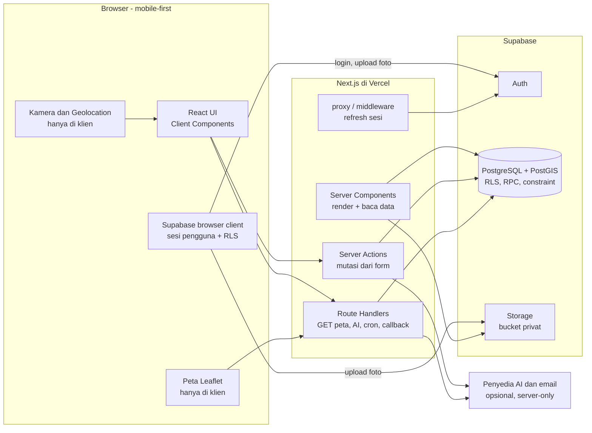
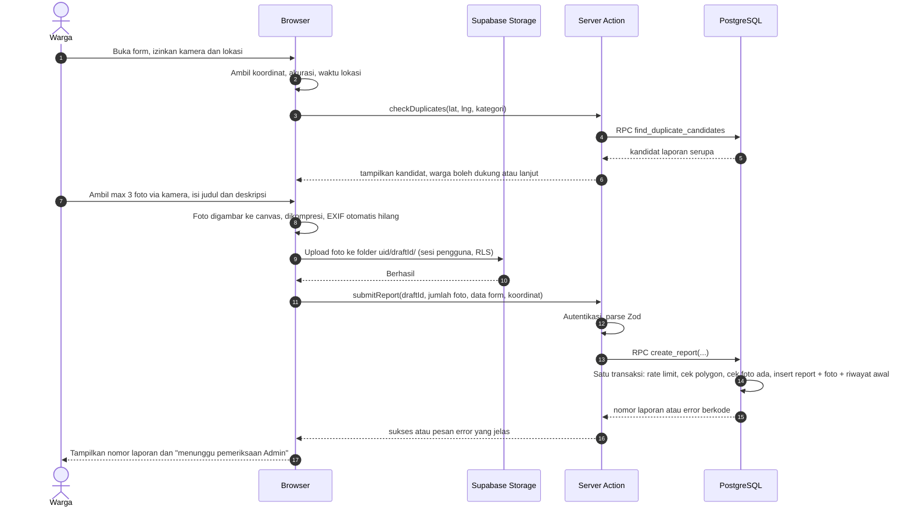
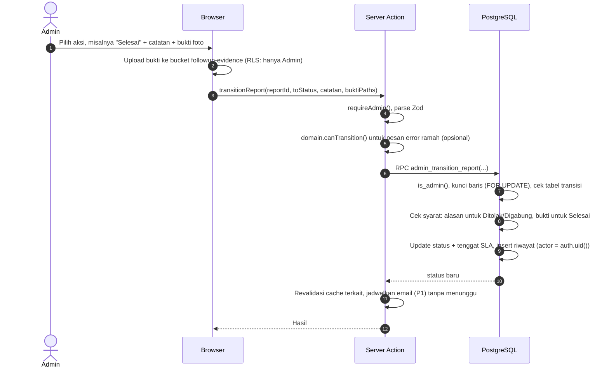
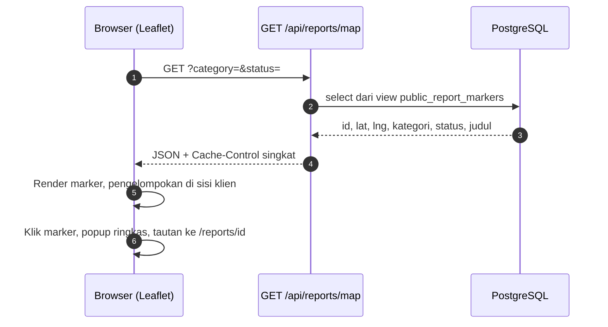
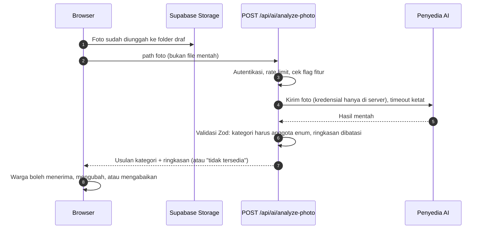

# ARCHITECTURE — Noto PATI

> **Versi:** 1.0 (draf)
> **Turunan dari:** `Noto_PATI_PRD_v1.md` (PRD v1.0, 23 Oktober 2026)
> **Status:** Acuan implementasi prototipe lomba
> **Cakupan dokumen:** tanggung jawab tiap komponen, batas antarlapisan, alur data, pembagian server/client, dan struktur folder.

Dokumen ini menjawab **"siapa bertanggung jawab atas apa, dan di mana batasnya"**. Dokumen ini tidak menggantikan PRD: kebutuhan fungsional, aturan status, dan kriteria penerimaan tetap bersumber dari PRD. Bila keduanya bertentangan, PRD menang dan dokumen ini diperbaiki.

Setiap keputusan penting disertai **Mengapa**, supaya keputusan dapat ditinjau ulang, bukan hanya diikuti. Bagian yang bertanda **[Keputusan terbuka]** belum dikunci di PRD dan perlu disepakati tim (daftar lengkap di Bagian 14).

---

## Daftar Isi

1. [Prinsip Arsitektur](#1-prinsip-arsitektur)
2. [Gambaran Sistem dan Tanggung Jawab Komponen](#2-gambaran-sistem-dan-tanggung-jawab-komponen)
3. [Lapisan Aplikasi dan Aturan Dependensi](#3-lapisan-aplikasi-dan-aturan-dependensi)
4. [Batas Server dan Client](#4-batas-server-dan-client)
5. [Autentikasi dan Otorisasi](#5-autentikasi-dan-otorisasi)
6. [Alur Data Kritis](#6-alur-data-kritis)
7. [Database: Aturan yang Dijaga di Dalamnya](#7-database-aturan-yang-dijaga-di-dalamnya)
8. [Struktur Folder](#8-struktur-folder)
9. [Strategi Rendering dan Caching](#9-strategi-rendering-dan-caching)
10. [Concern Lintas Lapisan](#10-concern-lintas-lapisan)
11. [Integrasi Eksternal](#11-integrasi-eksternal)
12. [Lingkungan, Konfigurasi, dan Secret](#12-lingkungan-konfigurasi-dan-secret)
13. [Strategi Pengujian per Lapisan](#13-strategi-pengujian-per-lapisan)
14. [Keputusan Terbuka](#14-keputusan-terbuka)
15. [Keterlacakan PRD ke Arsitektur](#15-keterlacakan-prd-ke-arsitektur)
16. [Checklist untuk Perubahan yang Menyentuh Batas](#16-checklist-untuk-perubahan-yang-menyentuh-batas)

---

## 1. Prinsip Arsitektur

| # | Prinsip | Mengapa (berasal dari PRD) |
|---|---|---|
| P1 | **Server adalah pengambil keputusan; browser hanya antarmuka.** Validasi di klien hanya untuk kenyamanan pengguna. | PRD 8.2 dan 12.1: transisi status, validasi wilayah, dan keputusan administratif tidak boleh bergantung pada UI. |
| P2 | **Database adalah garis pertahanan terakhir.** Aturan yang tidak boleh dilanggar (transisi status, polygon wilayah, satu dukungan per akun) juga dijaga RLS, constraint, dan fungsi database. | Bila ada bug di lapisan aplikasi, data tetap tidak bisa rusak. |
| P3 | **Rahasia hanya hidup di server.** Service role key dan API key pihak ketiga tidak pernah masuk bundle browser. | PRD 11 dan 15.1. |
| P4 | **Layanan opsional tidak boleh menggagalkan alur inti.** AI dan email adalah tambahan; pelaporan manual harus tetap jalan. | PRD 13.1, 15.3, FR-13, AI-01. |
| P5 | **Waktu selalu berasal dari server/database**, bukan jam perangkat. | PRD 10.1: SLA dan riwayat status. |
| P6 | **Teks label dan metadata dipusatkan.** Teks konfigurasi, disclaimer, dan label aplikasi disimpan di `config/labels.ts` agar mudah dipelihara dan konsisten di seluruh aplikasi. | Menghindari teks hardcoded tersebar; memudahkan perubahan copy atau terjemahan. |
| P7 | **Sederhana dulu.** Satu aplikasi Next.js, tanpa service backend terpisah, tanpa ORM, tanpa message queue, kecuali ada alasan tertulis. | Prototipe lomba dengan waktu terbatas; setiap komponen tambahan menambah titik gagal saat demo. |

---

## 2. Gambaran Sistem dan Tanggung Jawab Komponen

### 2.1 Diagram konteks



### 2.2 Siapa bertanggung jawab atas apa

| Komponen | Bertanggung jawab atas | **Bukan** tanggung jawabnya |
|---|---|---|
| **Browser (Client Components)** | Interaksi dan tampilan; akses kamera dan geolokasi; kompresi foto dan pembuangan EXIF; peta Leaflet; validasi form untuk kenyamanan; upload foto ke Storage atas nama sesi pengguna | Memutuskan hak akses; menentukan status; menghitung SLA; memvalidasi wilayah sebagai keputusan final; memegang rahasia |
| **Next.js: Server Components** | Merender halaman publik, detail laporan, dashboard; membaca data lewat lapisan `queries`; membuat signed URL foto | Mutasi data (gunakan Server Action) |
| **Next.js: Server Actions** | Mutasi dari form: kirim laporan, ubah status, gabungkan, tolak, dukung, rating, ajukan buka kembali. Setiap action: autentikasi, parse Zod, otorisasi, panggil fungsi database, kembalikan hasil | Aturan bisnis yang harus atomik (itu milik fungsi database); pembacaan data untuk fetch dari klien |
| **Next.js: Route Handlers** | Endpoint yang dipanggil klien lewat HTTP: `GET` marker peta, analisis foto AI (P1), cron pembersihan, callback OAuth, webhook | Menjadi tempat utama logika bisnis |
| **Next.js: proxy/middleware** | Menyegarkan sesi Supabase di cookie; redirect kasar demi UX | **Bukan** pengaman. Otorisasi sungguhan ada di titik akses data (Bagian 5) |
| **Supabase Auth** | Identitas, sesi, login email/Google, penerbitan JWT | Role aplikasi (disimpan di `profiles`) |
| **PostgreSQL + PostGIS** | Sumber kebenaran data; RLS; constraint; fungsi RPC untuk operasi atomik; validasi polygon; pencarian radius; waktu server | Rendering, integrasi AI/email |
| **Supabase Storage** | Menyimpan foto laporan dan bukti tindak lanjut di bucket privat; membatasi ukuran dan tipe file | Menentukan foto mana yang boleh publik (diputuskan lapisan server, lihat 7.4) |
| **Vercel** | Hosting Next.js, preview deployment, cron terjadwal | Penyimpanan data |
| **Penyedia AI / email** | Layanan opsional yang dipanggil hanya dari server | Alur inti pelaporan |

**Mengapa satu aplikasi Next.js, bukan frontend dan backend terpisah?** PRD 12.1 sudah menetapkannya. Untuk tim kecil, ini mengurangi jumlah repo, deployment, dan konfigurasi CORS. Konsekuensinya: pemisahan frontend/backend harus dijaga **secara disiplin lewat struktur folder dan aturan import** (Bagian 3), karena framework tidak memaksanya.

---

## 3. Lapisan Aplikasi dan Aturan Dependensi

### 3.1 Empat lapisan

```
┌──────────────────────────────────────────────────────────────┐
│ 1. PRESENTASI      src/app, src/features/*/components,       │
│                    src/components                            │
│    Halaman, layout, komponen UI, route handler (tipis)       │
├──────────────────────────────────────────────────────────────┤
│ 2. APLIKASI        src/features/*/actions.ts, queries.ts     │
│    Orkestrasi satu use case: auth -> validasi -> otorisasi   │
│    -> panggil infrastruktur -> hasil                         │
├──────────────────────────────────────────────────────────────┤
│ 3. DOMAIN          src/domain                                │
│    Aturan murni TypeScript: status, SLA, label, tipe geo.    │
│    TIDAK mengimpor Next.js, React, atau Supabase             │
├──────────────────────────────────────────────────────────────┤
│ 4. INFRASTRUKTUR   src/server, src/lib/supabase/browser.ts   │
│    Klien Supabase, storage, adapter AI/email, rate limit,    │
│    guard autentikasi, peta error database                    │
└──────────────────────────────────────────────────────────────┘
```

### 3.2 Aturan dependensi

| Lapisan | Boleh mengimpor | Dilarang mengimpor |
|---|---|---|
| Presentasi | Aplikasi (actions, queries), Domain, `components/ui` | `src/server/*` langsung; klien Supabase `admin` dalam kondisi apa pun |
| Aplikasi | Domain, Infrastruktur | Komponen React |
| Domain | Hanya TypeScript standar dan sesama `domain` | `next/*`, `react`, `@supabase/*`, `src/server/*`, `src/features/*` |
| Infrastruktur | Domain, tipe | Komponen, `features/*` |

Arah panah selalu ke dalam (Presentasi → Aplikasi → Domain; Aplikasi → Infrastruktur). **Domain tidak tahu apa-apa tentang dunia luar.**

**Mengapa domain dibuat murni?** Aturan seperti "transisi mana yang sah" dan "kapan SLA terlambat" adalah inti nilai produk dan paling sering diuji. Bila murni, Vitest dapat mengujinya dalam milidetik tanpa mock Supabase/Next.js, dan aturan yang sama dipakai UI (menampilkan tombol yang sah) tanpa menduplikasi logika.

### 3.3 Cara aturan ditegakkan (bukan hanya diharapkan)

1. **`server-only`**: setiap file di `src/server/**` dan `features/*/queries.ts` dimulai dengan `import "server-only"`. Bila file itu tanpa sengaja ditarik ke Client Component, **build gagal**, bukan bocor diam-diam. Ini penegak terpenting untuk P3.
2. **ESLint `no-restricted-imports`** untuk kemurnian domain (cuplikan):

   ```js
   // eslint.config.mjs (cuplikan)
   {
     files: ["src/domain/**/*.ts"],
     rules: {
       "no-restricted-imports": ["error", {
         patterns: ["next", "next/*", "react", "react-dom", "@supabase/*",
                    "@/server/*", "@/features/*", "@/components/*"],
       }],
     },
   },
   ```
3. **Code review**: lihat checklist Bagian 16.

---

## 4. Batas Server dan Client

### 4.1 Pilih mekanisme berdasarkan tujuan

| Kebutuhan | Gunakan | Mengapa |
|---|---|---|
| Menampilkan halaman dengan data | **Server Component** | Data dibaca di server; tidak ada kunci/query di bundle; HTML awal cepat di jaringan seluler (PRD 11: <3 detik) |
| Interaksi (kamera, peta, form, filter) | **Client Component** (`"use client"`), sekecil mungkin | Hanya bagian interaktif yang dikirim sebagai JavaScript |
| Mutasi yang dipicu form/tombol | **Server Action** | Terintegrasi dengan form, typed, mudah revalidasi cache |
| Data yang dibaca ulang oleh klien (marker peta, refetch filter) | **Route Handler `GET`** | Server Action adalah mekanisme mutasi (POST) dan tidak cocok untuk pembacaan berulang |
| Panggilan panjang/streaming ke AI, cron, webhook, callback OAuth | **Route Handler** | Butuh endpoint HTTP dengan kontrak sendiri |
| Operasi atomik multi-tabel dengan aturan bisnis | **Fungsi database (RPC)**, dipanggil dari Server Action | Satu transaksi; tidak bisa dilewati; ditegakkan meski ada bug di aplikasi |

> **Server Action = endpoint HTTP publik.** Walau dipanggil dari form, siapa pun bisa mengirim request ke sana. Maka **setiap action wajib mengautentikasi dan mengotorisasi sendiri**; jangan mengandalkan "tombolnya hanya muncul untuk Admin".

### 4.2 Apa yang boleh langsung dari browser ke Supabase

PRD 12.1 mengizinkan "operasi sederhana yang diizinkan" langsung dari browser. Agar tidak melebar, daftar izinnya **eksplisit** (allow-list). Segala sesuatu di luar daftar ini lewat server.

| Operasi dari browser | Alasan boleh | Penjaga |
|---|---|---|
| Login/logout, OAuth Google, refresh token | Memang tanggung jawab Supabase Auth | Supabase Auth |
| Upload foto laporan ke Storage | Menghindari batas ukuran body request di function server (3 foto ≈ 3 MB lebih) dan memangkas latensi | Storage RLS: hanya ke folder `auth.uid()`; batas ukuran dan MIME di level bucket |
| Upload bukti tindak lanjut (Admin) | Alasan sama | Storage RLS: hanya Admin |
| Membaca data publik yang sudah diekspos lewat **view publik** (opsional) | Data memang publik | RLS pada view/tabel |

**Semua penulisan ke tabel (`reports`, riwayat, dukungan, rating, anggaran) dilakukan lewat Server Action → RPC, bukan `insert/update` langsung dari browser.**

**Mengapa seketat itu?** Kebijakan RLS `INSERT/UPDATE` yang longgar adalah sumber celah paling umum di aplikasi Supabase. Dengan **tidak memberi kebijakan tulis sama sekali** ke klien pada tabel inti, tidak ada "kebijakan yang lupa dibatasi". Semua jalur tulis lewat sedikit fungsi yang mudah diaudit.

> Pengecualian yang dapat dipertimbangkan: dukungan laporan (FR-11, P1) boleh `insert` langsung dengan RLS + unique constraint bila ingin lebih sederhana. Default dokumen ini tetap lewat server agar rate limiting dan aturan "bukan laporan sendiri" terpusat.

### 4.3 Tiga klien Supabase, tiga tujuan

| Klien | File | Berjalan di | Identitas | RLS | Dipakai untuk |
|---|---|---|---|---|---|
| **Browser** | `src/lib/supabase/browser.ts` | Browser | Sesi pengguna | Berlaku | Auth UI, upload foto |
| **Server (user-scoped)** | `src/server/supabase/server.ts` | Server (baca cookie sesi) | Sesi pengguna | **Berlaku** | **Default** untuk semua query dan RPC di server |
| **Admin (service role)** | `src/server/supabase/admin.ts` | Server saja (`server-only`) | Tanpa batas | **Dilewati** | Hanya daftar pengecualian di bawah |

**Aturan emas: default ke klien server user-scoped.** Dengan begitu RLS tetap menjadi jaring pengaman walau kode aplikasi salah. Service role melewati RLS, sehingga setiap pemakaiannya adalah keputusan yang disengaja.

**Allow-list penggunaan service role** (tambahan wajib lewat review):

| Kegunaan | Lokasi |
|---|---|
| Membuat signed URL untuk foto yang **sudah diputuskan aman ditampilkan publik** | `src/server/storage/signed-urls.ts` |
| Cron pembersihan foto draf yatim (upload yang tidak pernah menjadi laporan) | `app/api/cron/cleanup-drafts/route.ts` |
| Skrip operasional di luar aplikasi web: penetapan role Admin, impor anggaran terkontrol | `scripts/*` |

Klien admin **tidak pernah** dipakai di dalam Server Action yang menerima input langsung dari pengguna untuk menulis data bisnis.

---

## 5. Autentikasi dan Otorisasi

### 5.1 Sesi

- Supabase Auth menerbitkan sesi; di Next.js sesi dibawa lewat **cookie** menggunakan paket `@supabase/ssr`.
- `src/proxy.ts` (bernama `middleware.ts` pada Next.js 15; periksa versi terpasang) hanya **menyegarkan token** agar Server Components melihat sesi yang valid.
- Di server, identitas diverifikasi dengan `supabase.auth.getUser()` (atau metode verifikasi JWT yang direkomendasikan versi `@supabase/ssr` terpasang). **Jangan memakai data sesi dari cookie mentah sebagai bukti identitas**, karena cookie dikendalikan klien.

### 5.2 Role

- Role (`warga` | `admin`) disimpan di tabel `profiles.role`, **bukan** di `user_metadata` (field itu dapat diubah pengguna sendiri).
- `profiles` dibuat otomatis lewat trigger saat user baru terdaftar, dengan role default `warga`.
- Pengguna **tidak boleh mengubah role-nya**: hak `UPDATE` pada kolom `role` dicabut dari `authenticated` (hanya kolom `display_name` yang boleh diubah).
- Admin ditetapkan lewat proses administratif: `scripts/assign-admin.ts` (service role, dijalankan manual) atau SQL langsung. Tidak ada endpoint web untuk menjadi Admin.

```sql
-- Sketsa ilustrasi. Bentuk final ada di supabase/migrations/.
revoke update on public.profiles from authenticated;
grant  update (display_name) on public.profiles to authenticated;

create function public.is_admin() returns boolean
language sql stable security definer set search_path = public as $$
  select exists (
    select 1 from public.profiles
    where id = (select auth.uid()) and role = 'admin'
  );
$$;
```

### 5.2.1 Empat lapis otorisasi (defense in depth)

| Lapis | Contoh | Tujuan | Boleh jadi satu-satunya pengaman? |
|---|---|---|---|
| 1. UI | Tombol "Verifikasi" hanya tampil untuk Admin | Pengalaman pengguna | **Tidak** |
| 2. Proxy/middleware | Redirect `/admin` ke login jika tak ada sesi | UX kasar, hemat request | **Tidak** |
| 3. Server (guard) | `requireAdmin()` di `admin/layout.tsx`, di setiap query dan action admin | Menolak sebelum menyentuh data | Hampir, tetapi tidak cukup |
| 4. Database | RLS dan cek `is_admin()` di dalam RPC | Garis terakhir; tetap berlaku bila lapis 1-3 bocor | **Ya, wajib ada** |

**Mengapa tidak cukup di proxy/middleware?** Layout/proxy tidak melindungi pembacaan data yang dilakukan di titik lain, dan pernah ada celah di Next.js (CVE-2025-29927) yang memungkinkan middleware dilewati pada versi lama. Pelajarannya umum: **otorisasi harus berada sedekat mungkin dengan data**.

### 5.3 Matriks akses (ringkas)

`-` = tidak ada akses. "RPC" = hanya lewat fungsi database yang memeriksa `auth.uid()`/`is_admin()`.

| Objek | Pengunjung | Warga | Admin |
|---|---|---|---|
| `public_reports` (view tanpa `reporter_id`) | Baca | Baca | Baca |
| `reports` (tabel dasar) | - | Baca milik sendiri | Baca semua |
| Tulis ke `reports` | - | RPC `create_report` | RPC `admin_*` |
| `public_report_timeline` (view: status, waktu, catatan publik) | Baca | Baca | Baca |
| `report_status_history` (audit internal, ada `actor_id`) | - | - | Baca; hanya ditulis oleh RPC (append-only) |
| `report_photos` | - (foto publik lewat signed URL dari server) | Baca milik sendiri | Baca semua |
| `report_supports` | - | RPC (unik per akun, bukan laporan sendiri) | Baca |
| `report_ratings`, `reopen_requests` | - | RPC (hanya pelapor, hanya setelah `Selesai`) | Baca; keputusan lewat RPC |
| `sla_policies` | - | Baca | Baca; ubah lewat migrasi/skrip |
| `budget_documents`, `budget_items` | Baca **yang sudah dipublikasikan** | Sama | Baca semua; publikasi lewat RPC |
| `profiles` | - | Baca/ubah `display_name` sendiri | Baca |

Setiap sel pada matriks ini harus punya **uji RLS** (pgTAP) untuk tiga peran (PRD 17.1).

---

## 6. Alur Data Kritis

### 6.1 Membuat laporan (FR-02, FR-03, FR-04, FR-10)



Hal yang perlu dipahami:

- **Laporan baru ada di database hanya setelah langkah RPC sukses.** Sebelum itu, foto di Storage hanyalah file yatim. Ini memenuhi aturan PRD: tidak boleh ada "sukses palsu".
- **Di dalam RPC `create_report`** (semuanya satu transaksi, sehingga atomik):
  1. `auth.uid()` wajib ada.
  2. Batas laju per pengguna (mis. N laporan per jam, nilai dari konfigurasi).
  3. Koordinat berada di polygon Kabupaten Pati (`ST_Covers`, urutan **longitude, latitude**).
  4. 1-3 foto, dan semua path foto benar-benar ada di `storage.objects` pada folder milik pengguna.
  5. Insert `reports` dengan status `received`, `created_at`/`received_at` = `now()` database, `verification_due_at` = `received_at` + kebijakan SLA.
  6. Insert `report_photos` (`photo_type = 'report'`).
  7. Insert baris pertama `report_status_history` (`null → received`).
- Kegagalan di langkah mana pun membatalkan seluruh transaksi.
- **Foto diunggah langsung dari browser** (bukan lewat Server Action) karena batas ukuran body di platform serverless dan karena Server Action memiliki batas ukuran body bawaan. Periksa batas yang berlaku pada versi Next.js/Vercel yang dipakai.
- **"Hanya kamera" adalah kebijakan UX, bukan jaminan keamanan.** Server tidak bisa membuktikan bahwa sebuah JPEG berasal dari kamera. Karena itu `CameraCapture` memakai `getUserMedia` (bukan `<input type="file">`, yang bisa menawarkan galeri), dan server hanya dapat membatasi tipe, ukuran, dan jumlah. Ini sejalan dengan PRD 15.2 yang menyatakan koordinat dan foto bukan bukti mutlak.
- **Pembuangan EXIF** terjadi sebagai efek samping menggambar foto ke `canvas` lalu `toBlob()`: file hasil adalah JPEG baru tanpa metadata asli. Ini perlu diuji di perangkat nyata (PRD 11).
- File yatim (upload tanpa laporan) dibersihkan oleh cron `cleanup-drafts`.

### 6.2 Admin mengubah status (FR-07, FR-08, FR-09)



- **Sumber kebenaran transisi ada di database**: tabel `report_status_transitions` (data, bukan `if-else` tersebar). `domain/report-status.ts` mencerminkannya untuk UI dan pengujian; sebuah **uji paritas** memastikan keduanya tidak melenceng.
- **`Selesai → Dibuka Kembali` tidak lewat `admin_transition_report`.** Transisi itu hanya terjadi lewat `admin_decide_reopen`, karena PRD mensyaratkan permintaan Warga yang disetujui.
- `FOR UPDATE` mencegah dua Admin mengubah laporan yang sama bersamaan (balapan).
- **Aturan SLA saat transisi** (PRD 10.1):

  | Peristiwa | Efek pada tenggat |
  |---|---|
  | Laporan masuk (`received`) | `verification_due_at = received_at + verification_hours` |
  | `Diverifikasi` | `handling_due_at = verified_at + handling_hours` |
  | Pembukaan kembali disetujui | `handling_due_at` baru (siklus baru), dicatat di riwayat |
  | Perubahan kebijakan SLA | Tidak mengubah tenggat laporan yang sedang berjalan |

  Karena tenggat **disimpan sebagai timestamp saat peristiwa terjadi**, perubahan kebijakan berikutnya otomatis tidak menyentuh laporan lama. Status "sisa waktu / terlambat" **dihitung saat dibaca** dari tenggat dan `now()` server, sehingga tidak butuh cron untuk menandai keterlambatan.

### 6.3 Peta publik (FR-05)



- Untuk dataset prototipe, **ambil semua marker publik sekali**, lalu filter dan kelompokkan di klien. Kontrak `getPublicMarkers(filter)` dibuat terpisah agar kelak dapat diganti ke bounding box/viewport tanpa mengubah komponen peta.
- Leaflet memakai `window`, jadi komponen peta harus **client-only**: `next/dynamic(..., { ssr: false })` **di dalam Client Component** (Server Component tidak boleh memakai opsi `ssr: false`).
- Atribusi OpenStreetMap wajib tampil. Tile server publik OSM punya kebijakan penggunaan; cukup untuk prototipe, tinjau bila trafik membesar.

### 6.4 Halaman detail laporan publik (FR-06)

Server Component membaca dari `public_reports` dan `public_report_timeline`, lalu:

1. Menghitung label SLA dari tenggat dan `now()` server memakai `domain/sla.ts`. Payload menyertakan `serverNow` agar hitung mundur di klien tidak terpengaruh jam perangkat yang salah.
2. Membuat **signed URL berumur pendek** untuk foto yang boleh tampil publik (klien admin, hanya di `signed-urls.ts`).
3. Menyisipkan *island* kecil Client Component untuk tombol interaktif (dukung/rating/ajukan buka kembali, P1).

Identitas pelapor tidak pernah ada di payload karena view publik memang tidak memuat kolom itu.

### 6.5 Analisis foto AI (AI-01, P1)



- **AI hanya mengusulkan.** Tidak ada jalur kode dari modul AI ke tabel `reports` atau ke RPC status/penggabungan (PRD 13.3).
- Kegagalan/timeout/keyakinan rendah → kembalikan "tidak tersedia"; form manual jalan seperti biasa.
- Akses lewat antarmuka `PhotoAnalyzer` sehingga penyedia (Roboflow, vision model lain) dapat diganti tanpa menyentuh route handler (Bagian 11).

### 6.6 Halaman Anggaran (BG-01, BG-02)

- MVP: data dimuat lewat proses terkontrol (`scripts/import-budget.ts` dari CSV yang sudah diverifikasi manual) ke `budget_documents` dan `budget_items`; dokumen baru berstatus **belum dipublikasikan** sampai diverifikasi.
- RLS membuat Pengunjung hanya dapat membaca dokumen yang sudah `is_published`.
- Penjumlahan dan total dihitung oleh kode deterministik di `domain/budget.ts` dan/atau SQL, **bukan oleh AI** (PRD 14.3). Komponen tampilan menerima `amount_type` (mis. `pagu`) dan **selalu** menampilkan labelnya; komponen tidak dapat dirender tanpa properti sumber (dokumen, halaman).
- Halaman bersifat statis dengan revalidasi saat publikasi (Bagian 9).
- P1 (impor CSV lewat UI Admin): unggah → parse di server → ringkasan validasi → persetujuan Admin → publikasi. P2 (scraping, OCR, penjelasan AI) di luar arsitektur MVP.

---

## 7. Database: Aturan yang Dijaga di Dalamnya

### 7.1 Prinsip

- Skema, RLS, fungsi, trigger, dan view dikelola sebagai **migrasi SQL** di `supabase/migrations/` (PRD 12.2). Tidak ada perubahan skema lewat dashboard di lingkungan bersama.
- Tipe TypeScript dihasilkan dengan `supabase gen types typescript` ke `src/types/database.ts` dan **tidak diedit manual**. Klien dibuat bertipe `createClient<Database>`.
- Semua `timestamptz` disimpan UTC dan diisi `default now()` oleh database. Zona tampilan WIB (Asia/Jakarta) diterapkan di lapisan presentasi.

### 7.2 Invarian yang ditegakkan database

| Invarian | Mekanisme |
|---|---|
| Titik laporan berada di dalam Kabupaten Pati | Fungsi `is_within_pati(lng, lat)` memakai `ST_Covers` terhadap tabel `regions`; dipanggil di `create_report`, ditambah trigger `BEFORE INSERT` sebagai pengaman kedua |
| Transisi status hanya yang sah | Tabel `report_status_transitions` diperiksa di `admin_transition_report` |
| Penolakan wajib alasan; penggabungan wajib `merged_into_report_id` | Pemeriksaan di RPC + `CHECK` constraint |
| `Selesai` wajib catatan dan bukti | Pemeriksaan di RPC (ada `report_photos` bertipe `followup`) |
| Riwayat tidak dapat diubah | Tidak ada kebijakan `UPDATE/DELETE`; hanya RPC yang `INSERT` |
| Satu dukungan per akun per laporan | `UNIQUE (report_id, user_id)`; RPC menolak laporan milik sendiri |
| Rating hanya oleh pelapor setelah `Selesai`; satu per laporan | RPC + unique constraint |
| Dukungan menumpuk pada laporan utama saat penggabungan | RPC `admin_transition_report` ke `merged` tidak menyalin dukungan ganda; hitung dukungan membaca laporan utama |
| Role tidak dapat diubah pengguna | Pencabutan hak `UPDATE` pada kolom `role` |

### 7.3 Spasial

```sql
-- Sketsa ilustrasi. Perhatikan urutan: LONGITUDE dulu, baru LATITUDE.
create table public.regions (
  id         text primary key,                       -- 'pati'
  name       text not null,
  boundary   geometry(MultiPolygon, 4326) not null,
  source     text not null,                          -- asal data, lisensi
  verified_at date
);
create index regions_boundary_gix on public.regions using gist (boundary);

create function public.is_within_pati(p_lng double precision, p_lat double precision)
returns boolean language sql stable set search_path = public, extensions as $$
  select exists (
    select 1 from public.regions r
    where r.id = 'pati'
      and ST_Covers(r.boundary, ST_SetSRID(ST_MakePoint(p_lng, p_lat), 4326))
  );
$$;
```

- Lokasi laporan disimpan sebagai `geography(Point, 4326)` agar pencarian radius (`ST_DWithin`) berjalan dalam **meter**; indeks GiST pada kolom lokasi.
- `ST_Covers` (bukan `ST_Contains`) agar titik tepat di batas dihitung berada di dalam, sesuai PRD 12.3.
- Kandidat duplikat: `ST_DWithin` pada radius dari konfigurasi + `category_id` sama + hanya status yang relevan. Hasilnya **saran**, tidak pernah penggabungan otomatis (PRD 8.3).
- Data batas wilayah dan README asal/lisensi/CRS disimpan di `supabase/data/`. **Fitur validasi lokasi tidak dianggap selesai sebelum data ini terverifikasi dan lulus uji dalam/luar/tepi** (PRD 12.3, Keputusan 1 di PRD 21).

### 7.4 Data publik vs privat

- Tabel dasar tidak pernah diekspos ke Pengunjung. Yang diekspos adalah **view** (`public_reports`, `public_report_markers`, `public_report_timeline`) yang **secara struktural tidak memuat** `reporter_id`, akurasi lokasi mentah, catatan internal, atau `actor_id`.
- Karena view dengan hak pemilik melewati RLS tabel dasar, filter visibilitas **ditulis eksplisit di dalam view** dan diuji pgTAP.
- Bucket foto bersifat **privat**. Foto publik ditayangkan lewat signed URL yang dibuat server setelah aplikasi memutuskan foto itu aman. Konsekuensi: halaman detail dirender dinamis (URL kedaluwarsa); bila perlu performa lebih, salin turunan "aman publik" ke bucket publik terpisah. **[Keputusan terbuka: Kebijakan akses foto, PRD 21]**
- **[Keputusan terbuka]** Laporan berstatus apa yang "publik" (PRD 5.1 butir 5 dan FR-05 tidak merincinya). Usulan awal, dipusatkan di satu definisi view:
  - Publik: `received` (diberi label *belum diverifikasi*), `verified`, `in_progress`, `resolved`, `reopened`.
  - Tidak publik: `rejected` (hanya pelapor dan Admin). `merged` tidak muncul di peta; detailnya mengarah ke laporan utama.

  Alasan `received` ikut publik: PRD 10.1 meminta SLA verifikasi tampil di halaman publik, yang berarti laporan itu harus terlihat sejak diterima. Pertimbangan sebaliknya: risiko spam tampil publik sebelum diperiksa.

### 7.5 Daftar RPC (kontrak antara aplikasi dan database)

| RPC | Pemanggil | Ringkas |
|---|---|---|
| `create_report` | Warga | Bagian 6.1 |
| `find_duplicate_candidates` | Warga, Admin | Pencarian radius + kategori |
| `admin_transition_report` | Admin | Verifikasi, tolak, gabung, proses, selesai |
| `admin_decide_reopen` | Admin | Setujui/tolak pembukaan kembali (P1) |
| `support_report` | Warga | Dukungan (P1) |
| `rate_report`, `request_reopen` | Warga | P1 |
| `admin_publish_budget_document` | Admin | Publikasi setelah verifikasi |

Semua RPC berstatus `SECURITY DEFINER` hanya bila perlu, dengan `set search_path` eksplisit, `REVOKE EXECUTE ... FROM public, anon`, `GRANT EXECUTE ... TO authenticated`, dan **memeriksa `auth.uid()`/`is_admin()` di dalamnya** (karena DEFINER melewati RLS).

**Mengapa logika bisnis di fungsi database, bukan di TypeScript?** Karena (a) harus atomik di satu transaksi (status + riwayat + tenggat), (b) tidak bisa dilewati oleh klien mana pun, dan (c) tetap benar walau ada kode aplikasi baru yang lupa memeriksa. Bayarannya: SQL perlu diuji (pgTAP) dan sulit di-debug dibanding TypeScript. Karena itu fungsi dibuat **sedikit, kecil, dan satu tujuan**; aturan yang bisa murni ditaruh di `domain/` untuk UI dan uji unit.

---

## 8. Struktur Folder

```
noto-pati/
├─ ARCHITECTURE.md
├─ README.md
├─ .env.example                  # daftar variabel TANPA nilai rahasia
├─ eslint.config.mjs             # termasuk aturan batas lapisan
├─ next.config.ts
├─ vitest.config.ts
├─ playwright.config.ts
├─ public/                       # aset statis: ikon, manifest (PWA P1)
│
├─ scripts/                      # operasional, dijalankan manual/CI, BUKAN bagian bundle web
│  ├─ assign-admin.ts            # tetapkan role Admin (service role)
│  ├─ import-budget.ts           # muat CSV APBD terverifikasi
│  └─ check-boundary.ts          # uji titik dalam/luar/tepi terhadap polygon
│
├─ supabase/
│  ├─ config.toml
│  ├─ migrations/                # skema, RLS, RPC, trigger, view (berurutan)
│  ├─ seed.sql                   # kategori, kebijakan SLA, data demo (is_demo = true)
│  ├─ data/pati-boundary/        # sumber polygon + README asal/lisensi/CRS
│  └─ tests/                     # pgTAP: RLS per peran, constraint, polygon
│
├─ e2e/                          # Playwright: alur utama lintas halaman
│
└─ src/
   ├─ proxy.ts                   # (middleware.ts di Next 15) refresh sesi + redirect kasar
   │
   ├─ app/                       # PRESENTASI: routing saja, file dibuat tipis
   │  ├─ layout.tsx              # banner "Prototipe lomba", font, provider
   │  ├─ (public)/
   │  │  ├─ page.tsx             # landing: fungsi dan batasan prototipe
   │  │  ├─ map/page.tsx
   │  │  ├─ reports/[id]/page.tsx
   │  │  └─ budget/page.tsx
   │  ├─ (auth)/
   │  │  ├─ login/page.tsx
   │  │  └─ auth/callback/route.ts      # penukaran kode OAuth/email
   │  ├─ (citizen)/
   │  │  ├─ report/new/page.tsx         # form pelaporan
   │  │  └─ my-reports/page.tsx
   │  ├─ admin/
   │  │  ├─ layout.tsx                  # requireAdmin()
   │  │  ├─ page.tsx                    # antrean laporan
   │  │  └─ reports/[id]/page.tsx       # tinjau, ubah status, riwayat
   │  └─ api/
   │     ├─ reports/map/route.ts        # GET marker publik
   │     ├─ ai/analyze-photo/route.ts   # P1
   │     └─ cron/cleanup-drafts/route.ts
   │
   ├─ features/                  # APLIKASI + komponen per fitur (vertical slice)
   │  ├─ reports/
   │  │  ├─ actions.ts           # "use server": submitReport, checkDuplicates, ...
   │  │  ├─ queries.ts           # server-only: getPublicReport, getMyReports
   │  │  ├─ schemas.ts           # Zod, dipakai klien (UX) dan server (otoritas)
   │  │  └─ components/          # ReportForm, CameraCapture, ReportTimeline, ...
   │  ├─ admin/
   │  │  ├─ actions.ts           # transitionReport, mergeReport, rejectReport
   │  │  ├─ queries.ts           # antrean, detail admin
   │  │  └─ components/
   │  ├─ map/
   │  │  ├─ components/          # ReportMap.client.tsx, MapFilters
   │  │  └─ use-map-markers.ts
   │  ├─ budget/                 # queries, components (BudgetTable, SourceCitation)
   │  ├─ auth/                   # form login, tombol Google
   │  └─ ai/                     # P1: komponen saran kategori
   │
   ├─ domain/                    # DOMAIN: murni TypeScript
   │  ├─ report-status.ts        # kode status, label Indonesia, transisi sah
   │  ├─ sla.ts                  # hitung sisa waktu/terlambat dari tenggat + now
   │  ├─ budget.ts               # penjumlahan deterministik, tipe nilai
   │  ├─ categories.ts           # slug kategori tetap
   │  └─ geo.ts                  # tipe Coordinates, helper urutan lng/lat
   │
   ├─ server/                    # INFRASTRUKTUR (semua file: import "server-only")
   │  ├─ supabase/
   │  │  ├─ server.ts            # klien user-scoped (default)
   │  │  └─ admin.ts             # service role (allow-list, Bagian 4.3)
   │  ├─ auth/guards.ts          # requireUser, requireAdmin, getOptionalUser
   │  ├─ storage/signed-urls.ts
   │  ├─ ai/                     # antarmuka PhotoAnalyzer + adapter penyedia (P1)
   │  ├─ email/                  # antarmuka Mailer + adapter (P1)
   │  ├─ rate-limit.ts
   │  ├─ cache.ts                # pembungkus revalidasi (isolasi API cache per versi Next)
   │  └─ errors.ts               # peta kode error DB -> pesan pengguna
   │
   ├─ lib/                       # utilitas yang aman di server dan klien
   │  ├─ supabase/browser.ts     # klien browser
   │  ├─ action-result.ts        # tipe ActionResult<T>, helper ok()/fail()
   │  ├─ image/compress.ts       # kompres canvas, target ~1 MB
   │  └─ format.ts               # tanggal WIB, angka rupiah
   │
   ├─ components/
   │  ├─ ui/                     # shadcn/ui
   │  └─ shared/                 # Navbar, StatusBadge, ReportCard, shared UI
   │
   ├─ config/
   │  ├─ env.server.ts           # validasi Zod untuk variabel server
   │  ├─ env.client.ts           # validasi Zod untuk NEXT_PUBLIC_*
   │  └─ labels.ts               # SATU tempat teks "prototipe/simulasi/SLA target"
   │
   └─ types/
      └─ database.ts             # dihasilkan, jangan edit manual
```

### 8.1 Konvensi

- **`app/` tipis.** File `page.tsx` hanya merakit: ambil data dari `features/*/queries`, render komponen dari `features/*/components`. Logika tidak ditulis di `page.tsx`.
- **Satu fitur, satu folder.** Hal-hal yang berubah bersamaan (form, action, schema) tinggal berdekatan. Lintas-fitur hanya lewat `domain/` atau `components/shared`.
- **Penamaan:** kode dan rute memakai bahasa Inggris (`/map`, `/report/new`); teks yang dilihat pengguna memakai bahasa Indonesia dan berasal dari `config/labels.ts` atau `domain/*`. Kode status disimpan sebagai identifier Inggris (`received`, `verified`, ...) dan label Indonesia (`Diterima`, `Diverifikasi`, ...) hanya di lapisan tampilan. Ini memisahkan data yang stabil dari teks yang bisa berubah.
- **Akhiran `.client.tsx`** untuk komponen yang mutlak browser-only (peta, kamera), agar mudah dikenali saat review.
- **`scripts/` tidak boleh diimpor dari `src/`** dan sebaliknya hanya boleh mengimpor `src/domain`.

### 8.2 Templat Server Action

Setiap action mengikuti urutan yang sama sehingga review mudah:

```ts
// src/features/reports/actions.ts
"use server";

import { requireUser } from "@/server/auth/guards";
import { createServerSupabase } from "@/server/supabase/server";
import { revalidatePublicReports } from "@/server/cache";
import { mapDbError } from "@/server/errors";
import { ok, fail, type ActionResult } from "@/lib/action-result";
import { submitReportSchema } from "./schemas";

export async function submitReport(
  input: unknown,
): Promise<ActionResult<{ reportNumber: string }>> {
  const user = await requireUser();                       // 1. siapa yang memanggil?
  const parsed = submitReportSchema.safeParse(input);     // 2. bentuk data sah?
  if (!parsed.success) {
    return fail("VALIDATION", parsed.error.flatten().fieldErrors);
  }
  const supabase = await createServerSupabase();          // 3. klien atas nama pengguna: RLS tetap berlaku
  const { data, error } = await supabase.rpc("create_report", {
    /* 4. aturan bisnis dan atomisitas ada di database */
  });
  if (error) return mapDbError(error);                    // 5. kegagalan terduga = hasil, bukan throw
  await revalidatePublicReports();                        // 6. segarkan cache terkait
  return ok({ reportNumber: data.report_number });        // 7. kembalikan hasil bertipe
}
```

`ActionResult<T>` adalah union terdiskriminasi `{ ok: true, data } | { ok: false, error: { code, message, fieldErrors? } }`. **Mengapa tidak `throw`?** Error yang diharapkan (di luar wilayah, laporan terlalu sering, status tidak sah) adalah bagian normal alur dan harus menjadi pesan yang jelas bagi pengguna; `throw` dicadangkan untuk bug dan kegagalan tak terduga.

---

## 9. Strategi Rendering dan Caching

| Rute | Rendering | Data | Cache | Alasan |
|---|---|---|---|---|
| `/` | Statis | Tidak ada | Statis | Tidak berubah; tercepat |
| `/map` | Kerangka statis + peta client-only | `GET /api/reports/map` | `s-maxage` singkat | Peta butuh refetch dari klien; marker boleh tertinggal beberapa detik |
| `/reports/[id]` | Dinamis | `public_reports`, timeline, signed URL | Tanpa cache halaman | Signed URL kedaluwarsa; tombol bergantung pada pengguna |
| `/budget` | Statis dengan revalidasi berbasis tag | `budget_*` terpublikasi | Direvalidasi saat publikasi | Data jarang berubah, sangat sering dibaca |
| `/report/new` | Dinamis, butuh login | Kategori | Tanpa cache | Spesifik pengguna |
| `/my-reports` | Dinamis, privat | Laporan milik sendiri | `no-store` | Data pribadi |
| `/admin/**` | Dinamis, privat | Semua data admin | `no-store`, `noindex` | Data sensitif; jangan ter-cache atau terindeks |

Mekanisme cache Next.js berubah antarversi. **Seluruh pemanggilan API cache dibungkus di `src/server/cache.ts`** sehingga perubahan versi cukup diperbaiki di satu file.

---

## 10. Concern Lintas Lapisan

### 10.1 Tiga lapis validasi

| Lapis | Alat | Tujuan |
|---|---|---|
| Klien | React Hook Form + Zod | Umpan balik cepat |
| Server | Zod (**skema yang sama**, `features/*/schemas.ts`) | Otoritas atas bentuk dan batas data |
| Database | `CHECK`, `NOT NULL`, FK, RPC | Garis terakhir |

Skema Zod dibagi antar klien dan server supaya aturan tidak menyimpang; server tetap yang memutuskan (PRD 12.2).

### 10.2 Katalog kode error

RPC melempar error berkode; `server/errors.ts` memetakannya ke pesan Indonesia yang ramah.

| Kode | Arti |
|---|---|
| `VALIDATION` | Data tidak sah (disertai galat per kolom) |
| `UNAUTHENTICATED` / `FORBIDDEN` | Belum masuk / tidak berhak |
| `OUT_OF_BOUNDARY` | Lokasi di luar Kabupaten Pati |
| `PHOTO_MISSING` / `PHOTO_LIMIT` | Foto tidak ditemukan / melebihi 3 |
| `RATE_LIMITED` | Terlalu sering mengirim |
| `INVALID_TRANSITION` | Transisi status tidak diizinkan |
| `REASON_REQUIRED` / `EVIDENCE_REQUIRED` | Alasan atau bukti wajib belum ada |
| `ALREADY_SUPPORTED` / `OWN_REPORT` | Dukungan ganda / laporan milik sendiri |

### 10.3 Centralized Labels dan Metadata (P6)

- `config/labels.ts` memegang teks konfigurasi aplikasi: nama aplikasi, tagline, wilayah, tahun anggaran, dan disclaimer yang relevan.
- Label dan metadata terpusat memudahkan pembaruan copy atau internasionalisasi tanpa menyentuh komponen UI.
- Komponen dapat mengimpor konstanta dari `config/labels.ts` untuk konsistensi (contoh: `APP_CONFIG.name`, `DISCLAIMERS.budgetSourceNotice`).
- Tidak ada komponen atau teks yang menyatakan "ditangani pemerintah/OPD" kecuali ada sumber data nyata; pernyataan seperti itu tidak ada dalam `labels.ts`.

### 10.4 Waktu

Semua waktu otoritatif berasal dari database. Klien hanya **menampilkan**. Hitung mundur di UI menghitung selisih terhadap `serverNow` yang dikirim bersama payload.

### 10.5 Privasi foto dan lokasi

- Izin kamera dan lokasi diminta hanya saat form dibuka, dan lokasi diambil sekali (bukan `watchPosition`), sesuai PRD 15.2.
- Peringatan "hindari wajah, pelat nomor, dan data pribadi" ditampilkan di langkah foto.
- Foto asli tidak pernah dimodifikasi untuk mengubah kesan kerusakan; turunan (blur, kompresi) adalah berkas terpisah.
- Lokasi publik hanya titik laporan; akurasi dan waktu pengambilan lokasi bersifat internal.
- Kebijakan retensi dan penghapusan ditetapkan sebelum dipakai dengan laporan nyata (PRD 15.2).

### 10.6 Rate limiting

- **Pengiriman laporan:** dihitung di dalam `create_report` (jumlah laporan pengguna dalam rentang waktu). Tanpa layanan tambahan dan tidak dapat dilewati.
- **Pemanggilan AI (P1):** perlu penghitung terpisah. **[Keputusan terbuka]** tabel penghitung di Postgres (tanpa infrastruktur baru) atau layanan terkelola seperti Upstash.

### 10.7 Observabilitas

- Log terstruktur di server dengan `requestId`, nama operasi, dan kode hasil.
- **Jangan mencatat** koordinat mentah, isi laporan, atau identitas pelapor ke log.
- Kegagalan layanan opsional (AI, email) dicatat dan **tidak** membatalkan alur utama.

### 10.8 PWA (P1)

Hanya meng-*cache* aset statis (PRD 21). Service worker **tidak boleh** meng-cache respons `/api/*`, halaman admin, atau panggilan ke domain Supabase. Pengiriman laporan offline tidak dijanjikan.

### 10.9 Aksesibilitas

Komponen `components/ui` (shadcn) dipakai sebagai dasar; setiap form memiliki label eksplisit, galat terhubung ke kolomnya, dan navigasi keyboard diuji (PRD 11). Tombol kamera dan lokasi harus mudah dijangkau ibu jari pada layar ponsel.

---

## 11. Integrasi Eksternal

Semua layanan eksternal diakses lewat **antarmuka kecil milik kita**, dengan adapter per penyedia.

```ts
// src/server/ai/types.ts (sketsa)
export interface PhotoAnalyzer {
  analyze(input: { imageUrl: string; signal: AbortSignal }): Promise<PhotoAnalysis | null>;
}
```

| Integrasi | Prioritas | Pola | Kegagalan |
|---|---|---|---|
| **Analisis foto AI** | P1 | Antarmuka `PhotoAnalyzer`; adapter per penyedia; output divalidasi Zod; *feature flag* `FEATURE_AI_PHOTO`; timeout ketat | Kembalikan `null` → form manual tetap jalan |
| **Email notifikasi** | P1 | Antarmuka `Mailer`; dikirim setelah transaksi selesai lewat `after()` dari `next/server` | Dicatat dan diabaikan; laporan tetap tersimpan (FR-13) |
| **Ubin peta OSM** | P0 | Dipakai langsung oleh Leaflet di klien; atribusi wajib | Peta kosong tanpa ubin, marker/daftar tetap berfungsi |
| **Penyedia AI final** | - | **Belum dipilih** sampai evaluasi kualitas, privasi, biaya, dan retensi data selesai (PRD 12.2, 13.3) | - |

**Mengapa antarmuka dan adapter?** Pemilihan penyedia AI belum final (PRD 21). Dengan antarmuka, mengganti Roboflow ke model lain, atau mematikan fitur, tidak menyentuh route handler maupun UI. Bila perlu menjamin pengiriman email lebih kuat, tingkatkan ke pola *outbox* (tabel antrean + cron) tanpa mengubah pemanggil.

---

## 12. Lingkungan, Konfigurasi, dan Secret

| Variabel | Lingkup | Catatan |
|---|---|---|
| `NEXT_PUBLIC_SUPABASE_URL` | Browser + server | Publik |
| `NEXT_PUBLIC_SUPABASE_ANON_KEY` (atau *publishable key*) | Browser + server | Aman di browser **hanya jika RLS benar** |
| `SUPABASE_SERVICE_ROLE_KEY` (atau *secret key*) | **Server saja** | Hanya dibaca `server/supabase/admin.ts` dan `scripts/`. **Jangan pernah** diberi awalan `NEXT_PUBLIC_` |
| `AI_PROVIDER_API_KEY` | Server saja | P1 |
| `EMAIL_PROVIDER_API_KEY` | Server saja | P1 |
| `CRON_SECRET` | Server saja | Diverifikasi di route cron |
| `FEATURE_AI_PHOTO`, `FEATURE_EMAIL` | Server | Flag fitur opsional |

Nama kunci Supabase berbeda antar generasi (*anon/service_role* vs *publishable/secret*); ikuti dokumentasi versi proyek.

- Variabel divalidasi saat boot oleh `config/env.server.ts` dan `config/env.client.ts` (Zod). Aplikasi **gagal start** bila variabel wajib hilang, lebih baik daripada gagal diam-diam saat demo.
- `.env.example` di repo berisi nama variabel tanpa nilai; `.env*` berisi rahasia masuk `.gitignore`.
- Lingkungan yang disarankan untuk prototipe: **lokal** (Supabase CLI + Docker), serta **satu proyek Supabase terhosting** untuk preview/demo. Tambah proyek staging terpisah bila waktu memungkinkan. Jangan menjalankan uji RLS atau migrasi eksperimen langsung pada proyek yang dipakai demo.
- Data demo aman dan terverifikasi disiapkan sebagai `seed` untuk mengantisipasi kegagalan jaringan/kuota saat presentasi (PRD 15.3).

---

## 13. Strategi Pengujian per Lapisan

| Lapisan / concern | Alat | Yang diuji | Referensi PRD |
|---|---|---|---|
| Domain | Vitest | Transisi status, perhitungan SLA (termasuk siklus buka kembali), penjumlahan anggaran, label | 17.1 |
| Paritas transisi | Vitest + query ke DB lokal | `domain/report-status.ts` sama dengan tabel `report_status_transitions` | 8.2 |
| Aplikasi (actions) | Vitest dengan Supabase lokal | Urutan auth, validasi, pemetaan error; tidak sukses palsu | 17 (3, 4) |
| Database: RLS dan constraint | pgTAP (`supabase test db`) | Setiap sel matriks 5.3 untuk Pengunjung, Warga, Admin | 15.1, 17.1 |
| Spasial | pgTAP / `scripts/check-boundary.ts` | Titik dalam, luar, **tepat di batas**, serta kasus lng/lat tertukar | 12.3, 17.1 |
| Alur lintas lapisan | Playwright | Login → lapor (kamera/lokasi dengan mock) → Admin verifikasi → tampil di peta | 17.1 |
| Keamanan bundle | CI: `grep` atas `.next/static` untuk service role / secret | Tidak ada rahasia di bundle browser | 11 |
| Anggaran | Pencocokan manual + uji data | Setiap angka cocok dengan dokumen, halaman, jenis, versi | 17.1 |
| AI (P1) | Dataset berlabel | Evaluasi per kategori sebelum ditampilkan | 3, 17.1 |

Urutan CI yang disarankan: lint dan typecheck → Vitest → migrasi + pgTAP pada Supabase lokal → build (memastikan `server-only` tidak terlanggar) → Playwright.

---

## 14. Keputusan Terbuka

Butir 1-5 berasal dari PRD 21; butir 6-9 ditemukan saat menyusun arsitektur ini.

| # | Keputusan | Usulan default dokumen ini | Dampak jika berubah |
|---|---|---|---|
| 1 | Sumber polygon Kabupaten Pati | Belum ada; blokir fitur validasi lokasi sampai terverifikasi | Menentukan `regions` dan uji spasial |
| 2 | Nilai SLA demo final | 24 jam verifikasi, 7 hari penanganan (PRD 10.2), disimpan di `sla_policies` | Hanya data seed |
| 3 | Kebijakan akses foto (publik/privat, retensi) | Bucket privat + signed URL | Bila publik: bucket turunan terpisah; halaman detail bisa lebih statis |
| 4 | Penyedia AI foto | Belum dipilih; antarmuka `PhotoAnalyzer` | Hanya adapter |
| 5 | Provider email | Belum dipilih; antarmuka `Mailer` | Hanya adapter |
| 6 | **Status mana yang "publik"** | `received` s.d. `reopened` publik; `rejected` tidak; `merged` redirect (7.4) | Definisi view publik dan uji RLS |
| 7 | **Mekanisme rate limit AI** | Tabel penghitung di Postgres | Menambah layanan bila memilih Upstash |
| 8 | **Versi Next.js** | Periksa apakah 15 atau 16 | `middleware.ts` vs `proxy.ts`; API cache di `server/cache.ts` |
| 9 | **Upload foto**: langsung dari browser (sesi + Storage RLS) atau signed upload URL dari server | Langsung dari browser; cron membersihkan file yatim | Signed URL memberi kontrol server lebih ketat atas jumlah/jalur upload, dengan satu langkah tambahan |

---

## 15. Keterlacakan PRD ke Arsitektur

| Kebutuhan PRD | Dipenuhi oleh | Bagian |
|---|---|---|
| FR-01 Autentikasi dan role | Supabase Auth, `profiles.role`, `requireAdmin`, `scripts/assign-admin.ts` | 5 |
| FR-02 Membuat laporan | `submitReport` → RPC `create_report` | 6.1 |
| FR-03 Pengambilan foto | `CameraCapture` (`getUserMedia`), `lib/image/compress.ts` | 6.1, 10.5 |
| FR-04 Validasi lokasi | `is_within_pati` (`ST_Covers`), trigger pengaman | 7.3 |
| FR-05 Peta publik | `GET /api/reports/map`, `ReportMap.client.tsx`, view marker | 6.3 |
| FR-06 Detail laporan | Server Component + view publik + signed URL | 6.4 |
| FR-07 Dashboard Admin | `app/admin/*`, `features/admin`, RPC `admin_*` | 6.2 |
| FR-08 Riwayat status | `report_status_history` append-only, ditulis RPC | 6.2, 7.2 |
| FR-09 SLA | Tenggat tersimpan + `domain/sla.ts` + `<SlaBadge>` | 6.2, 10.3 |
| FR-10 Kandidat duplikat | RPC `find_duplicate_candidates` (`ST_DWithin`) | 6.1, 7.3 |
| FR-11 Dukungan (P1) | RPC `support_report` + `UNIQUE` | 7.2, 7.5 |
| FR-12 Rating dan buka kembali (P1) | RPC `rate_report`, `request_reopen`, `admin_decide_reopen` | 7.5 |
| FR-13 Email (P1) | `Mailer` + `after()`, tidak memblokir | 11 |
| BG-01 / BG-02 Anggaran | `budget_*`, `is_published`, `scripts/import-budget.ts`, `domain/budget.ts` | 6.6 |
| AI-01 Analisis foto (P1) | `/api/ai/analyze-photo`, `PhotoAnalyzer` | 6.5, 11 |
| NFR Keamanan | `server-only`, tiga klien Supabase, RLS, RPC, rate limit | 3, 4, 5, 10.6 |
| NFR Privasi | View publik, bucket privat, EXIF, lokasi sekali | 7.4, 10.5 |
| NFR Keandalan | Layanan opsional terisolasi, transaksi atomik, tanpa sukses palsu | 6.1, 11 |
| NFR Ketelusuran | Riwayat audit, metadata sumber anggaran | 6.6, 7.2 |
| Centralized labels | `config/labels.ts` | 10.3 |

---

## 16. Checklist untuk Perubahan yang Menyentuh Batas

Gunakan pada setiap PR yang menambah action, route handler, tabel, atau integrasi.

- [ ] **Autentikasi:** apakah action/handler memanggil `requireUser()`/`requireAdmin()` di dalamnya, bukan mengandalkan UI atau proxy?
- [ ] **Validasi:** apakah input diparse Zod di server, bukan hanya di klien?
- [ ] **Klien Supabase:** apakah memakai klien user-scoped? Bila memakai `admin`, apakah masuk allow-list 4.3 dan disetujui reviewer?
- [ ] **Aturan bisnis:** apakah mutasi multi-langkah berada dalam satu RPC atomik, bukan beberapa `insert/update` berurutan dari TypeScript?
- [ ] **RLS:** apakah tabel/view baru punya RLS, dan apakah ada uji pgTAP untuk Pengunjung, Warga, Admin?
- [ ] **Privasi:** apakah ada kolom yang dapat membocorkan identitas pelapor atau catatan internal melalui view publik?
- [ ] **Rahasia:** apakah ada variabel baru? Apakah server-only dan tercantum di `.env.example` tanpa nilai?
- [ ] **Kegagalan:** apa yang terjadi bila layanan eksternal gagal? Apakah alur inti tetap berjalan dan tidak menampilkan sukses palsu?
- [ ] **Label:** apakah teks status/SLA/anggaran memakai `config/labels.ts` dan komponen bersama?
- [ ] **Dokumen:** apakah perubahan ini mengubah batas yang dijelaskan di dokumen ini? Jika ya, perbarui ARCHITECTURE.md di PR yang sama.

---

*Dokumen ini hidup. Perubahan pada PRD yang memengaruhi lapisan, batas server/client, atau aturan keamanan harus dicerminkan di sini dan dicatat agar kebutuhan, backlog, dan pengujian tetap selaras.*
