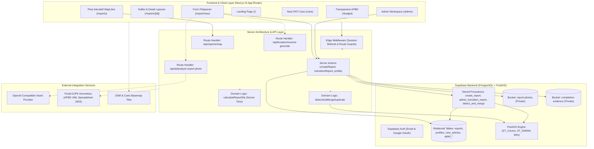

# Noto PATI — Project Context & Single Source of Truth

> **Tanggal Audit Terakhir:** 6 November 2026  
> **Versi Dokumen:** 1.0.0  
> **Status Repositori:** Aktif (Branch `main`, Git Commit ref `e449fc5`)  
> **Tujuan Dokumen:** *Single Source of Truth* arsitektur, fungsionalitas, model data, status implementasi, dan acuan teknis untuk pengembang serta *AI coding agents*.

---

## 1. Project Overview

### 1.1. Nama & Deskripsi Proyek
**Noto PATI** ("Noto" berasal dari bahasa Jawa yang berarti *menata*) adalah platform web *civic-tech* partisipatif untuk warga Kabupaten Pati, Jawa Tengah. Platform ini memfasilitasi pelaporan kerusakan infrastruktur publik (seperti jalan berlubang, drainase tersumbat/amblas, penerangan jalan umum mati, dan jembatan rusak) sekaligus menyandingkannya secara transparan dengan data alokasi anggaran infrastruktur pada APBD Kabupaten Pati T.A. 2025.

### 1.2. Latar Belakang Masalah
Kanal aduan konvensional di tingkat daerah sering menghadapi tiga kendala sistemik:
1. **Laporan Tanpa Kepastian (Ketidakjelasan Tindak Lanjut):** Laporan warga kerap menggantung tanpa tenggat penyelesaian yang terukur atau transparansi progres.
2. **Penumpukan Laporan Ganda (*Duplicate Reports*):** Satu titik kerusakan fasilitas umum di jalur padat sering dilaporkan berulang kali oleh banyak warga, membebani antrean verifikasi petugas.
3. **Keterputusan dengan Realitas Anggaran Daerah:** Dokumen APBD berbentuk ratusan halaman PDF formal (Perda/Perbup) yang sulit dipahami warga umum, sehingga masyarakat tidak dapat menghubungkan kerusakan di lingkungannya dengan ketersediaan pos anggaran daerah.

### 1.3. Tujuan Utama
- Memudahkan warga Kabupaten Pati menyampaikan laporan kerusakan fasilitas publik secara cepat (< 2 menit) melalui foto dan geolokasi presisi.
- Memberikan transparansi penanganan laporan melalui linimasa perubahan status dan simulasi pemantauan SLA (*Service Level Agreement*).
- Mengurangi beban verifikasi petugas melalui deteksi dan penggabungan otomatis laporan duplikat berbasis batas spasial-temporal (*Spatial-Temporal Merge*).
- Meningkatkan literasi keselamatan dan pemeliharaan fasilitas kota melalui modul edukasi kontekstual (**Noto PATI Care**).
- Membuka wawasan publik mengenai porsi belanja infrastruktur APBD Kabupaten Pati melalui otomasi ekstraksi data DJPK Kemenkeu.

### 1.4. Ruang Lingkup Proyek
- **Wilayah Operasional:** Terbatas secara ketat pada batas geografis **Kabupaten Pati, Jawa Tengah** (divalidasi dengan poligon spasial PostGIS di sisi server).
- **Kategori Infrastruktur:** 8 kategori baku (`jalan`, `lampu`, `drainase`, `jembatan`, `tanggul`, `trotoar`, `rambu`, `lainnya`).
- **Platform:** Web application yang mengutamakan kenyamanan perangkat genggam (*mobile-first responsive web*).

### 1.5. Target Pengguna
1. **Warga Kabupaten Pati:** Pelapor masalah infrastruktur, baik dengan login akun maupun secara anonim.
2. **Masyarakat Umum / Pengamat:** Pengunjung publik yang memantau sebaran kerusakan melalui peta interaktif, linimasa laporan, modul edukasi, dan anggaran APBD.
3. **Administrator Noto PATI:** Pengelola sistem yang memverifikasi laporan, memperbarui status penanganan, mengunggah bukti penyelesaian, dan memantau SLA.

### 1.6. Batasan dan Asumsi Proyek
- **Status Prototipe:** Noto PATI adalah inisiatif independen / prototipe *civic-tech*, bukan aplikasi kedinasan resmi Pemerintah Kabupaten Pati.
- **Simulasi SLA:** Tenggat verifikasi (24 jam) dan penyelesaian (7 hari) adalah simulasi kebutuhan demonstrasi prototipe, bukan standar pelayanan baku Pemkab Pati.
- **Simulasi Data Dinas:** Sebagian data tindak lanjut dinas dan angka agregasi pada antarmuka publik diberi label *Data Simulation Badge* untuk menjaga integritas informasi publik.

---

## 2. Product Vision & Goals

### 2.1. Nilai yang Ditawarkan (*Value Proposition*)
- **Kemudahan Pelaporan:** Kamera perangkat + deteksi GPS otomatis + saran analisis foto berbasis AI (opsional) = pelaporan tanpa hambatan teknis.
- **Akuntabilitas Waktu Nyata:** Pelacakan SLA transparan dan linimasa kronologis tanpa menampilkan identitas sensitif pelapor maupun admin.
- **Kerapian Antrean Data:** Duplikasi kerusakan di titik yang sama dalam rentang 50 meter dan 6 jam disatukan secara atomik ke dalam satu laporan utama berformat *thread* visual.
- **Literasi Warga:** Warga tidak hanya melapor, tetapi juga dibekali pemahaman bahaya dan tindakan aman mandiri melalui edukasi visual-first.

### 2.2. Sasaran Jangka Pendek & Jangka Panjang
- **Jangka Pendek (Fase Prototipe & Evaluasi):**
  - Menguji keandalan deteksi lokasi berbasis batas PostGIS Pati.
  - Memvalidasi akurasi deteksi duplikat spasial pada 30+ laporan uji.
  - Mengukur kecepatan pengisian form laporan di bawah 2 menit pada perangkat seluler.
- **Jangka Panjang (Pengembangan Lanjutan):**
  - Integrasi dua arah dengan sistem informasi dinas teknis (DPUTR, Disperkim, Dishub).
  - Peringkat prioritas penanganan otomatis (*Infrastructure Priority Ranking*) berdasarkan tingkat keparahan fisik dan kepadatan lalu lintas.

### 2.3. Batasan Produk (*Out of Scope*)
- Noto PATI **bukan** pengganti kanal aduan umum nasional (SP4N-LAPOR) dan tidak menangani aduan non-infrastruktur (misal: pelayanan bansos, sengketa tanah, atau perizinan).
- Noto PATI **tidak** mengarahkan warga melakukan perbaikan fisik mandiri yang berisiko bahaya keselamatan.

---

## 3. User Roles & Permissions

Sistem otorisasi Noto PATI ditegakkan secara berlapis: **PostgreSQL Row Level Security (RLS)** + **Server-side Guards** (`src/lib/auth/guards.ts`) + **Edge Middleware** (`src/middleware.ts`).

### 3.1. Definisi Peran Aktual

| Role | Identifikasi Sesi | Akses & Wewenang Aktual |
|---|---|---|
| **Public Visitor (Pengunjung Publik)** | Tanpa sesi (`auth.uid() IS NULL`) | - Menjelajah beranda, peta publik, daftar laporan publik, detail tiket, dan direktori Noto PATI Care.<br>- Melihat halaman transparansi anggaran APBD.<br>- Membuat laporan infrastruktur baru secara **anonim**.<br>- Melacak tiket laporan yang sudah dibuat via nomor tiket publik. |
| **Warga (Authenticated Citizen)** | Supabase Auth (`user_roles.role = 'warga'`) | - Semua hak akses Pengunjung Publik.<br>- Memiliki halaman profil (`/profile`) dan riwayat laporan pribadi (`/my-reports`).<br>- Laporan yang dikirim otomatis terhubung ke `reporter_id` pengguna.<br>- Hak merubah profil (nama lengkap, nomor telepon, avatar). |
| **Admin** | Supabase Auth (`user_roles.role = 'admin'`) | - Seluruh hak akses Warga.<br>- Akses area terproteksi `/admin` (dashboard metrik, antrean laporan, peta sebaran internal).<br>- Menjalankan aksi transisi status laporan (`admin_transition_report`) dari `diterima` &rarr; `diverifikasi`/`ditolak` &rarr; `diproses` &rarr; `selesai`.<br>- Mengunggah foto bukti penyelesaian ke bucket privat `completion-evidence`.<br>- Melihat identitas pelapor dan log audit internal (`admin_activity_logs`). |
| **Petugas OPD (Dinas)** | *Belum terpisah di schema* | Tercantum pada PRD awal, namun pada implementasi database aktual (enum `app_role`), peran operasional disatukan di bawah role **Admin** untuk kebutuhan demonstrasi prototipe. |

### 3.2. Matriks Hak Akses Data Aktual

| Tindakan / Sumber Daya | Publik | Warga | Admin | Penegak Keamanan (*Enforcement*) |
|---|:---:|:---:|:---:|---|
| Baca daftar & detail laporan publik | ✅ | ✅ | ✅ | RLS `reports` (`is_public_viewable`) |
| Baca koordinat & marker peta publik | ✅ | ✅ | ✅ | Route Handler `/api/reports/map` (status non-digabung) |
| Baca materi Noto PATI Care | ✅ | ✅ | ✅ | RLS `care_articles` (`is_published = true`) |
| Buat laporan baru | ✅ (anonim) | ✅ | ✅ | Stored Procedure `create_report` + boundary validation |
| Baca identitas pelapor (`reporter_id`) | ❌ | ❌ (kecuali miliknya) | ✅ | Column-level RLS & server projection |
| Baca catatan internal & audit logs | ❌ | ❌ | ✅ | RLS `admin_activity_logs` (`role = 'admin'`) |
| Jalankan transisi status laporan | ❌ | ❌ | ✅ | Stored Procedure `admin_transition_report` |
| Unggah bukti penyelesaian (*evidence*) | ❌ | ❌ | ✅ | Storage RLS bucket `completion-evidence` |
| Dukung laporan (*Upvote* / Endorse) | ❌ | ⚠️ *(UI stub)* | ❌ | *Belum ada tabel `report_upvotes` di database* |
| Beri rating penyelesaian / Buka kembali | ❌ | ❌ *(Planned)* | ❌ | *Belum diimplementasikan* |

---

## 4. Technology Stack

### 4.1. Rincian Teknologi & Versi Aktual

```
┌──────────────────────────────────────────────────────────────┐
│                       TECH STACK AUDIT                       │
├──────────────────────┬───────────────────────────────────────┤
│ Framework            │ Next.js 15.5.28 (App Router)         │
│ Core Runtime         │ React 19.1.0 + Node.js (TypeScript 5) │
│ Compiler & Bundler   │ Turbopack (dev & build)               │
│ UI & Design Engine   │ Tailwind CSS v4 + tw-animate-css      │
│ Component Primitives │ shadcn/ui (preset Nova) + Base UI     │
│ Iconography          │ @phosphor-icons/react v2.1.10         │
│ Database & Auth      │ Supabase (PostgreSQL 15+ & PostGIS)   │
│ Client SSR Bridge    │ @supabase/ssr v0.12.7                 │
│ Geospatial & Map     │ MapLibre GL JS v4.7.1 + react-map-gl  │
│ Forms & Validation   │ React Hook Form v7.90.0 + Zod v4.6.7  │
│ Visual Charts        │ Recharts v3.10.1                      │
│ AI Vision Provider   │ OpenAI-compatible Vision API Client   │
│ Unit/Domain Testing  │ Vitest v5.0.5 + JSDOM v30.1.3         │
│ E2E Testing          │ Playwright v1.64.1                    │
│ Scraper Scripting    │ Jiti CLI + Native HTTP Streaming      │
└──────────────────────┴───────────────────────────────────────┘
```

---

## 5. System Architecture

### 5.1. Diagram Arsitektur Sistem



### 5.2. Data Flow & Keamanan Kredensial
- **Client Anon/Auth:** Menggunakan `createClient()` dari `@/lib/supabase/server` yang membawa token cookie sesi pengguna. Semua pembacaan tunduk pada RLS.
- **Admin Operations:** Menggunakan `createAdminClient()` dari `@/lib/supabase/admin` yang memanfaatkan `SUPABASE_SERVICE_ROLE_KEY`. Klien ini **hanya dipanggil di lingkungan server-only** (`import "server-only"`) untuk operasi yang memerlukan bypass RLS (misalnya: penulisan foto laporan anonim, query thumbnail laporan yang digabung, dan pencatatan audit log). Kunci service role tidak pernah bocor ke bundel browser.
- **Foto & Bukti:** Seluruh bucket berstatus **privat**. Gambar hanya disajikan ke antarmuka web melalui **Signed URLs** berbatas waktu singkat yang di-generate di server (`getSignedPhotoUrls` dan `getSignedCompletionEvidenceUrls`).

---

## 6. Feature Documentation

### 6.1. Citizen Reporting (Pelaporan Kerusakan oleh Warga)
- **Status:** `IMPLEMENTED` (Verified)
- **Deskripsi:** Form interaktif terpandu untuk melaporkan kerusakan fisik fasilitas publik dengan dukungan kamera perangkat, koordinat geolokasi, dan validasi wilayah.
- **User Flow:**
  1. Warga membuka `/report/new` dan melihat stepper 3 langkah.
  2. **Langkah 1 (Foto):** Mengunggah 1–3 foto kerusakan (JPEG/PNG/WEBP, maks 5MB per file). GPS mulai dideteksi di latar belakang. Tombol "Analisis dengan AI" (opsional) mengisi field yang masih kosong tanpa menimpa editan warga.
  3. **Langkah 2 (Detail):** Sistem melakukan reverse geocoding untuk menyarankan detail lokasi. Warga melengkapi alamat, judul, kategori, dan deskripsi. Validasi per langkah menahan tombol Lanjut bila field belum valid atau lokasi berada di luar Kabupaten Pati.
  4. **Langkah 3 (Tinjau & Kirim):** Warga memeriksa ringkasan, menyetujui pernyataan, lalu menekan "Kirim Laporan". Server tetap memvalidasi koordinat di dalam poligon Pati, menyimpan laporan, mengunggah foto, dan memicu deteksi duplikat.
  5. Redirect ke `/report/success?reportId=...&ticket=...&category=...`.
- **Business Rules:**
  - Koordinat wajib berada di dalam poligon batas administratif Kabupaten Pati (`is_within_pati = true`). Klien melakukan pre-check dengan poligon sederhana; server tetap menjadi penjaga utama.
  - Foto wajib memiliki *magic bytes* valid (bukan sekadar ekstensi file palsu).
  - Toleransi akurasi GPS: jika akurasi > 100m, deteksi duplikat dilewati untuk mencegah salah gabung, dan warga diberi peringatan.
  - Data antar-langkah disimpan dalam satu state form; tombol Kembali dan Back browser tidak mereset isian. `beforeunload` aktif selama ada data yang belum terkirim.
  - Mode pengujian dari luar Pati: set `NEXT_PUBLIC_ENABLE_MOCK_LOCATION=true` agar form memakai koordinat acak di dalam Pati dan menampilkan banner peringatan. Set `false` untuk mengaktifkan validasi wilayah asli.
- **Komponen / Lokasi:**
  - Form UI: [`src/app/(citizen)/report/new/ReportForm.tsx`](file:///home/panther/Documents/Programming/noto-pati/src/app/(citizen)/report/new/ReportForm.tsx)
  - Logika stepper & validasi: [`src/app/(citizen)/report/new/report-stepper.ts`](file:///home/panther/Documents/Programming/noto-pati/src/app/(citizen)/report/new/report-stepper.ts)
  - Poligon pre-check klien: [`src/app/(citizen)/report/new/pati-boundary.ts`](file:///home/panther/Documents/Programming/noto-pati/src/app/(citizen)/report/new/pati-boundary.ts)
  - Server Action: [`src/app/(citizen)/report/new/actions.ts`](file:///home/panther/Documents/Programming/noto-pati/src/app/(citizen)/report/new/actions.ts)
  - Konfirmasi Sukses: [`src/app/(citizen)/report/success/page.tsx`](file:///home/panther/Documents/Programming/noto-pati/src/app/(citizen)/report/success/page.tsx)

### 6.2. Anonymous Reporting (Pelaporan Anonim)
- **Status:** `IMPLEMENTED` (Verified)
- **Deskripsi:** Kemampuan mengirim laporan tanpa harus mendaftar atau masuk ke akun terlebih dahulu.
- **User Flow & Aturan:**
  - Pengunjung tanpa sesi dapat langsung mengisi form di `/report/new`.
  - Kolom `reporter_id` pada tabel `reports` bernilai `NULL`.
  - Pelapor diberikan nomor tiket acak unik (format: `NP-YYYYMMDD-XXXX`) untuk memantau perkembangan di halaman publik `/reports/[id]`.
  - Pelapor anonim tidak memiliki akses ke halaman `/my-reports`.

### 6.3. PostGIS Boundary Validation & Reverse Geocoding
- **Status:** `IMPLEMENTED` (Verified)
- **Deskripsi:** Validasi server bahwa koordinat laporan benar-benar berada di dalam wilayah Kabupaten Pati, serta reverse geocoding alamat dengan cache terproteksi.
- **Mekanisme Teknis:**
  - Poligon resmi Kabupaten Pati di-seed dari file `pati.geojson` ke tabel `regions` melalui script `scripts/seed-pati-region.mjs`.
  - PostgreSQL Function `is_within_pati(p_lat, p_lng)` memeriksa ketercakupan titik menggunakan `ST_Covers(boundary, ST_SetSRID(ST_MakePoint(p_lng, p_lat), 4326))`.
  - Reverse geocode endpoint `/api/location/reverse-geocode` menggunakan rate limiting dan tabel cache `private.reverse_geocode_cache` berjarak 25 meter untuk menghemat kuota geocoder eksternal.

### 6.4. Duplicate Report Detection & Automatic Merge
- **Status:** `IMPLEMENTED` (Verified)
- **Deskripsi:** Deteksi otomatis laporan yang mengindikasikan kerusakan fisik yang sama, lalu menggabungkannya ke laporan utama tertua yang masih aktif.
- **Parameter & Aturan Deteksi (Deterministic Rules):**
  1. **Kategori Sama:** `new_report.category = candidate.category`.
  2. **Radius Spasial:** Maksimal **50 meter** (`ST_DWithin(location, candidate.location, 50.0)`).
  3. **Rentang Waktu:** Maksimal **6 jam** (`21.600 detik`).
  4. **Status Kandidat Aktif:** Status laporan utama harus `diterima`, `diverifikasi`, atau `diproses`.
  5. **Anti-Chain Rule:** Laporan kandidat harus memiliki `merged_into_report_id IS NULL` (laporan yang sudah digabung tidak boleh menjadi target penggabungan).
  6. **Prioritas Induk:** Jika ada lebih dari satu kandidat, sistem memilih laporan terlama (`ORDER BY created_at ASC LIMIT 1`).
  7. **Resiliensi Transaksi:** Jika RPC database mengalami kendala, modul memiliki *application fallback* di TypeScript (`src/lib/reports/duplicate-detector.ts`). Kegagalan deteksi duplikat tidak pernah membatalkan pengiriman laporan baru.
- **Lokasi Kode:**
  - DB Migration: `supabase/migrations/20261102100000_add_duplicate_report_merge_schema.sql`
  - Detector Logic: [`src/lib/reports/duplicate-detector.ts`](file:///home/panther/Documents/Programming/noto-pati/src/lib/reports/duplicate-detector.ts)
  - Unit Test: [`src/lib/reports/duplicate-detector.test.ts`](file:///home/panther/Documents/Programming/noto-pati/src/lib/reports/duplicate-detector.test.ts)

### 6.5. Related Reports Thread (Visual Thread Laporan Terkait)
- **Status:** `IMPLEMENTED` (Verified)
- **Deskripsi:** Antarmuka visual menyerupai *thread* media sosial pada halaman detail laporan utama (`/reports/[id]`), menampilkan kartu-kartu kompak laporan duplikat yang terhubung oleh garis vertikal.
- **Perilaku UI:**
  - Hanya muncul pada laporan utama yang memiliki setidaknya satu laporan terkait (`duplicateReports.length > 0`).
  - Laporan yang berstatus `digabung` menampilkan banner peringatan berwarna ungu yang mengarahkan pembaca kembali ke laporan utama.
  - Tiap kartu kompak memuat: thumbnail foto (atau ikon fallback), nomor tiket, judul laporan, tanggal, dan badge status `Digabung`.
  - Jika jumlah laporan melebihi batas awal (`initialLimit = 3`), tersedia tombol expand/collapse "Lihat Semua".
- **Lokasi Komponen:**
  - Komponen: [`src/features/reports/components/RelatedReportsThread.tsx`](file:///home/panther/Documents/Programming/noto-pati/src/features/reports/components/RelatedReportsThread.tsx)
  - Unit Test: [`src/features/reports/components/RelatedReportsThread.test.ts`](file:///home/panther/Documents/Programming/noto-pati/src/features/reports/components/RelatedReportsThread.test.ts)

### 6.6. Report Status Timeline & SLA Tracking
- **Status:** `IMPLEMENTED` (Verified)
- **Deskripsi:** Pelacakan linimasa status penanganan laporan secara kronologis dan penghitungan kepatuhan SLA demonstrasi.
- **Aturan SLA:**
  - **SLA Verifikasi:** 24 jam kalender sejak laporan diterima (`verification_due_at = created_at + 24 hours`).
  - **SLA Penanganan:** 7 hari kalender sejak status pertama kali berubah menjadi `diverifikasi` (`handling_due_at = verified_at + 7 days`).
  - Perubahan status menjadi `diproses` tidak mereset tenggat penanganan.
  - Menggunakan waktu server (*server-side calculation*) via `calculateReportSla(report, nowIsoString)`.
  - Keamanan: Kolom `changed_by` pada `report_status_history` dicabut dari akses publik (`revoke select ...`), sehingga nama/identitas admin pemeriksa tidak terekspos.
- **Lokasi Kode:**
  - Domain SLA: [`src/domain/sla.ts`](file:///home/panther/Documents/Programming/noto-pati/src/domain/sla.ts)
  - Unit Test SLA: [`src/domain/sla.test.ts`](file:///home/panther/Documents/Programming/noto-pati/src/domain/sla.test.ts) (37 tests)

### 6.7. Noto PATI Care (Visual-First Infrastructure Education)
- **Status:** `IMPLEMENTED` (Verified)
- **Deskripsi:** Modul edukasi literasi infrastruktur kota yang menyediakan panduan mengenali jenis kerusakan fisik, faktor penyebab, dampak sosial-lingkungan, tindakan aman mandiri warga, dan langkah pencegahan.
- **Penerapan Kontekstual:**
  - **Direktori Edukasi:** Halaman publik `/care` dan detail materi `/care/[slug]`.
  - **Visual-First Card di Alur Sukses:** Ditampilkan pada `/report/success` di bawah konfirmasi tiket, memuat ilustrasi SVG tematik sesuai kategori laporan (`RoadIllustration`, `DrainageIllustration`, dll.), daftar tindakan aman maksimal 3 item, dan tautan baca lengkap.
  - **Detail Laporan:** Terintegrasi di bagian bawah halaman laporan publik `/reports/[id]`.
  - **Graceful Degradation:** Dilengkapi fallback data statis (`mock-data.ts`) jika koneksi tabel `care_articles` bermasalah.
- **Lokasi Komponen:**
  - Fitur Care: [`src/features/care/`](file:///home/panther/Documents/Programming/noto-pati/src/features/care/)
  - Unit Test: [`src/features/care/care.test.ts`](file:///home/panther/Documents/Programming/noto-pati/src/features/care/care.test.ts) & [`src/features/care/visual-education.test.ts`](file:///home/panther/Documents/Programming/noto-pati/src/features/care/visual-education.test.ts)

### 6.8. APBD Data Scraping, Normalization & Storage
- **Status:** `IMPLEMENTED` (Verified)
- **Deskripsi:** Pipeline backend untuk mengekstrak data belanja infrastruktur resmi dari portal DJPK Kementerian Keuangan (Kabupaten Pati), menormalkannya, memvalidasi integritasnya, dan menyimpannya ke Supabase.
- **Alur Pipeline:**
  1. `scripts/scrape-apbd.ts`: Mengunduh file XML Spreadsheet 2003 resmi dari endpoint DJPK `csv_apbd` (Provinsi 11, Pemda 17 Kabupaten Pati), mengekstrak tabel akun, dan menyimpannya ke `data/raw/apbd/apbd_{tahun}_{periode}.json`.
  2. `src/features/apbd/normalizer.ts`: Membersihkan nilai numerik, menormalkan format tanggal, dan menghitung hash SHA-256 dokumen mentah.
  3. `src/features/apbd/validation.ts`: Memvalidasi kelengkapan baris dan ringkasan total anggaran dengan skema Zod.
  4. `src/features/apbd/importer.ts`: Menjalankan RPC database `import_apbd_snapshot` untuk menyimpan snapshot ke tabel `apbd_reports` dan `apbd_accounts` secara idempoten.
- **Unit Test:**
  - Parser Test: [`src/features/apbd/scraper/parser.test.ts`](file:///home/panther/Documents/Programming/noto-pati/src/features/apbd/scraper/parser.test.ts)
  - Normalizer Test: [`src/features/apbd/normalizer.test.ts`](file:///home/panther/Documents/Programming/noto-pati/src/features/apbd/normalizer.test.ts)
  - Importer Test: [`src/features/apbd/importer.test.ts`](file:///home/panther/Documents/Programming/noto-pati/src/features/apbd/importer.test.ts)

### 6.9. APBD Visualization Dashboard (Halaman Transparansi Anggaran)
- **Status:** `IN_PROGRESS` / `PARTIALLY_IMPLEMENTED` (Verified)
- **Deskripsi:** Halaman publik di `/budget` yang menyajikan visualisasi data anggaran infrastruktur.
- **Temuan Audit Aktual:**
  - Kerangka antarmuka, kartu breakdown dinas (DPUTR Bina Marga, DPUTR Pengairan, Dishub, Disperkim), persentase realisasi, dan lencana simulasi sudah terpasang rapi.
  - **Namun**, data pada `src/app/(public)/budget/page.tsx` saat ini masih menggunakan konstanta mock statis (`BUDGET_BREAKDOWN`). Integrasi query langsung ke tabel `apbd_reports` dan `apbd_accounts` di database Supabase belum disambungkan ke halaman ini.

### 6.10. Admin Workspace & Management
- **Status:** `IMPLEMENTED` (Verified)
- **Deskripsi:** Ruang kerja khusus administrator (`/admin`) untuk mengelola seluruh siklus hidup laporan warga.
- **Fitur Terverifikasi:**
  - Tabel antrean laporan terverifikasi dengan filter status, kategori, dan pencarian tiket.
  - Penghitungan indikator sisa waktu SLA per laporan secara dinamis.
  - Halaman aksi detail laporan (`/admin/reports/[id]`).
  - Eksekusi transisi status resmi melalui stored procedure atomik `admin_transition_report`.
  - Formulir pengunggahan bukti penyelesaian perbaikan fisik (*completion evidence*) saat menetapkan status `selesai`.
  - Audit logging otomatis ke tabel `admin_activity_logs`.
- **Catatan Koreksi Dokumentasi:** Dokumen lama `docs/ADMIN_SETUP.md` menyatakan bahwa dashboard admin masih menggunakan mock data. **Fakta aktual membuktikan** bahwa `src/features/admin/server-data.ts` dan `src/features/admin/actions.ts` sudah sepenuhnya terhubung ke database Supabase nyata.

### 6.11. Public Interactive Map
- **Status:** `IMPLEMENTED` (Verified)
- **Deskripsi:** Peta interaktif berbasis WebGL menggunakan MapLibre GL JS untuk memvisualisasikan sebaran kerusakan fasilitas publik di Kabupaten Pati.
- **Fitur:**
  - Dua mode tampilan yang bisa diganti tanpa mereset filter status/kategori: **Heatmap** (default) dan **Klaster**.
  - Heatmap GPU native dengan radius/intensitas mengikuti zoom, ramp warna transparan ke biru, kuning, lalu merah, dan memudar pada zoom 13-15.
  - Klik area heatmap pada zoom jauh akan melakukan zoom-in ke lokasi tersebut.
  - Titik per laporan tetap tampil berwarna status pada zoom dekat.
  - Klasterisasi WebGL dengan warna kepadatan: 2-5 biru, 6-20 kuning, 21+ merah; angka jumlah selalu tampil dengan kontras WCAG AA.
  - Pewarnaan titik berbasis status laporan yang konsisten dengan desain sistem.
  - Popup interaktif dengan foto thumbnail, nama jalan/lokasi, kategori, dan tombol detail.
  - Pergantian basemap (*Street OSM* vs *Satellite Imagery*).
  - Legenda adaptif per mode (kepadatan heatmap atau rentang klaster) plus warna status, terbaca di kedua basemap.
  - Default hanya status aktif yang tersedia di enum database: `diterima`, `diverifikasi`, `diproses`. Status `selesai`/`ditolak` hanya muncul jika difilter eksplisit; `ditutup`/`digabung` selalu dikecualikan. `dibuka_kembali` belum ada di enum `report_status` sehingga ditunda sampai migrasi skema disetujui.
  - Proyeksi data publik tidak pernah menyertakan `reporter_id`.
- **Konfigurasi terpusat:**
  - Token warna kepadatan: `DENSITY_COLORS` di [`src/config/theme.ts`](file:///home/panther/Documents/Programming/noto-pati/src/config/theme.ts) (terpisah dari warna status).
  - Ambang klaster, tuning heatmap, dan builder ekspresi murni: [`src/components/map/map-density.ts`](file:///home/panther/Documents/Programming/noto-pati/src/components/map/map-density.ts).
  - Filter status default dan validasi status peta: [`src/lib/reports/map-statuses.ts`](file:///home/panther/Documents/Programming/noto-pati/src/lib/reports/map-statuses.ts).
- **Lokasi Komponen:**
  - Peta: [`src/components/map/PublicReportsMap.tsx`](file:///home/panther/Documents/Programming/noto-pati/src/components/map/PublicReportsMap.tsx)
  - Route Handler: [`src/app/api/reports/map/route.ts`](file:///home/panther/Documents/Programming/noto-pati/src/app/api/reports/map/route.ts)

---

## 7. Database & Data Model

Semua skema database dikelola melalui migrasi SQL Supabase di `supabase/migrations/`.

### 7.1. Custom Types & Enums
- **`app_role`:** `'warga'`, `'admin'`.
- **`report_category`:** `'jalan'`, `'lampu'`, `'drainase'`, `'jembatan'`, `'tanggul'`, `'trotoar'`, `'rambu'`, `'lainnya'`.
- **`report_status`:** `'diterima'`, `'diverifikasi'`, `'diproses'`, `'selesai'`, `'dibuka_kembali'`, `'ditolak'`, `'digabung'`, `'ditutup'`.

### 7.2. Rincian Tabel Skema `public`

```
┌──────────────────────────┬────────────────────────────────────────────────────────┐
│ Tabel                    │ Fungsi Utama & Kolom Kunci                             │
├──────────────────────────┼────────────────────────────────────────────────────────┤
│ profiles                 │ Profil pengguna: id (FK auth.users), full_name, phone  │
│ user_roles               │ Penugasan RBAC: user_id (FK auth.users), role          │
│ reports                  │ Entitas laporan utama: id, ticket_number, reporter_id, │
│                          │ category, title, description, detail_location, status, │
│                          │ latitude, longitude, location (geography),             │
│                          │ location_accuracy_m, merged_into_report_id,            │
│                          │ verification_due_at, handling_due_at, verified_at      │
│ report_photos            │ Foto lampiran laporan: id, report_id, storage_path,    │
│                          │ sort_order, mime_type, file_size_bytes                 │
│ report_status_history    │ Linimasa transisi status: id, report_id, status,       │
│                          │ changed_by, note, proof_image_url, created_at          │
│ report_status_transitions│ Aturan validitas transisi antar status laporan         │
│ report_merge_logs        │ Audit penggabungan duplikat: parent_report_id,         │
│                          │ duplicate_report_id, distance_meters, time_diff_seconds│
│ regions                  │ Poligon batas wilayah Pati: code, name, boundary (geo) │
│ report_ai_analyses       │ Log hasil inferensi vision: model_name, detected_cat,  │
│                          │ confidence, damage_assessment                          │
│ admin_activity_logs      │ Audit aksi admin: admin_user_id, action_type, details  │
│ sla_policies             │ Konfigurasi SLA: target_hours, handling_days           │
│ care_articles            │ Materi Noto PATI Care: slug, category, title, content, │
│                          │ causes[], impacts[], safety_actions[], is_published    │
│ apbd_reports             │ Metadata snapshot APBD DJPK: fiscal_year, period_month,│
│                          │ total_revenue, total_expenditure, raw_hash             │
│ apbd_accounts            │ Baris akun belanja/pendapatan APBD: account_name,      │
│                          │ budget_amount, realization_amount, percentage          │
└──────────────────────────┴────────────────────────────────────────────────────────┘
```

### 7.3. Skema `private` (Internal Database Engine)
Tabel dan fungsi dalam skema `private` tidak diberi hak akses ke role `anon` maupun `authenticated`:
- `private.report_ai_analysis_rate_limits`: Pembatasan panggilan AI vision per pemanggil berbasis hash IP.
- `private.reverse_geocode_cache`: Cache hasil reverse geocoding koordinat dalam radius 25 meter.
- `private.reverse_geocode_state`: State pelindung konkurensi reverse geocode.
- `private.validate_report_location()`: Trigger otomatis pemasti koordinat di dalam batas Pati.
- `private.set_report_verification_due_at()`: Trigger otomatis inisialisasi tenggat SLA verifikasi 24 jam.

### 7.4. Aturan Transisi Status Laporan (*State Lifecycle*)
Transisi status ditegakkan secara atomik melalui stored procedure `admin_transition_report` dengan mekanisme `SELECT ... FOR UPDATE`:

```
[ Warga Submit ] ──> diterima
                        │
         ┌──────────────┴──────────────┐
         ▼                             ▼
   diverifikasi                     ditolak (Terminal)
         │
         ▼
     diproses
         │
         ▼
      selesai (Terminal + Bukti Wajib)

* Status "digabung" hanya dapat ditetapkan oleh sistem deteksi duplikat otomatis.
```

---

## 8. UI/UX & Design System

Desain antarmuka Noto PATI berakar pada spesifikasi desain sistem kustom yang ramah, jelas, dan mematuhi standar aksesibilitas WCAG AA (kontras minimal 4,5:1).

### 8.1. Color Tokens (Tailwind CSS v4 Inline Theme)
- **Brand Identity:**
  - `Primary / Default` (`#3B6EA5`): Biru sejuk untuk identitas utama, header, dan elemen navigasi aktif.
  - `Primary / Dark` (`#2F5F95`): Biru tua untuk state hover dan tombol aksi utama.
  - `Primary / Soft` (`#E3EEF8`): Latar belakang chip, badge kategori, dan sorotan lembut.
  - `Accent / Default` (`#A8532E`): Terracotta hangat untuk tombol aksi pelaporan, penanda penting, dan aksen khas daerah.
  - `Accent / Soft` (`#FCEBDF`): Latar belakang peringatan ramah dan kartu edukasi bahaya.
- **Neutral Palette:**
  - `Background` (`#F6F9FC`): Latar halaman utama yang bersih dan menenangkan mata.
  - `Surface` (`#FFFFFF`): Permukaan kartu, modal dialog, dan kontainer input.
  - `Border` (`#DCE5EE`): Garis pembatas kartu dan tabel.
  - `Text Primary` (`#1F2D3D`): Keterbacaan teks utama berkontras tinggi.
  - `Text Muted` (`#556577`): Keterangan sekunder dan metadata waktu.
- **Status Colors:**
  - `diterima`: Biru Muda (`#2C6A93` / bg `#E1F0F8`)
  - `diverifikasi`: Teal Sejuk (`#2F6568` / bg `#DDEFEF`)
  - `diproses`: Amber Hangat (`#7A5A12` / bg `#FBF0D2`)
  - `selesai`: Hijau Daun (`#2E6B45` / bg `#DDEFE2`)
  - `ditolak`: Merah Bata (`#8F3A3A` / bg `#F7DEDE`)
  - `digabung`: Ungu Lembut (`#594B86` / bg `#E9E5F3`)

### 8.2. Pola Interaksi & Aksesibilitas
- **Mobile-First Touch Target:** Semua elemen interaktif dan tombol memiliki area sentuh minimal 44x44px.
- **Ikonografi Terpadu:** Menggunakan ikon Phosphor (`@phosphor-icons/react`) secara konsisten di seluruh aplikasi via wrapper [`src/components/shared/icons.tsx`](file:///home/panther/Documents/Programming/noto-pati/src/components/shared/icons.tsx).
- **Graceful Loading:** Menggunakan Skeleton Loader pada komponen peta, daftar kartu, gambar, dan kartu edukasi visual.

---

## 9. AI & Data Intelligence

Bagian ini memisahkan secara tegas antara fitur kecerdasan buatan yang **sudah diimplementasikan** dengan konsep yang **masih berupa usulan**.

### 9.1. AI-Assisted Report Photo Analysis (`IMPLEMENTED` — Verified)
- **Mekanisme:** Layanan opsional di sisi server yang menganalisis foto pertama yang diunggah pelapor.
- **Teknologi:** Provider LLM Vision kompatibel dengan format OpenAI Chat Completions (misalnya GPT-4o-mini).
- **User Experience:**
  - Hanya berjalan saat pengguna menekan tombol **"Analisis dengan AI"**.
  - Rekomendasi hasil analisis (kategori, estimasi judul, dan deskripsi kerusakan) hanya mengisi input form yang masih kosong.
  - Tidak pernah mengunci input; pelapor memiliki hak penuh untuk mengubah data sebelum dikirim.
  - Laporan tetap dapat dikirim secara manual jika provider AI offline atau kuota habis.
- **Keamanan:** Kunci API (`AI_VISION_API_KEY`) hanya berada di server. Dilengkapi rate limit 5 request/window per pemanggil berbasis hash IP di tabel `private.report_ai_analysis_rate_limits`.

### 9.2. Duplicate Detection Engine (`IMPLEMENTED` — Verified)
- **Mekanisme:** **Bukan** berbasis AI deep-learning atau vector embedding, melainkan algoritma deterministik spasial-temporal menggunakan PostGIS `ST_DWithin` (radius 50 meter) dan selisih waktu 6 jam.
- **Karakteristik:** Cepat, murah, terprediksi, dan sepenuhnya dapat diaudit via tabel `report_merge_logs`.

### 9.3. Infrastructure Priority Ranking (`PROPOSED` — Belum Diimplementasikan)
- **Status Aktual:** Diusulkan dalam diskusi produk, namun pada kode backend saat ini (`src/features/admin/server-data.ts:137`), atribut `priority` masih di-hardcode menjadi `"sedang"`.
- **Rencana Konseptual:** Algoritma pemeringkatan otomatis berbasis kombinasi kepadatan laporan, frekuensi kerusakan jalan, dan jarak ke fasilitas vital (rumah sakit, pasar, sekolah).

### 9.4. Roboflow / Computer Vision Edge Detection (`PROPOSED` — Belum Diimplementasikan)
- **Status Aktual:** Disinggung dalam ide awal untuk deteksi tingkat keparahan lubang jalan (*pothole depth/severity*).
- **Hasil Audit:** Tidak ditemukan kode, SDK, atau konfigurasi Roboflow di repositori. Seluruh analisis foto saat ini ditangani melalui provider vision OpenAI-compatible.

---

## 10. Security, Privacy & Compliance

Noto PATI dirancang dengan prinsip **Privacy-by-Design** dan **Defense-in-Depth**:

1. **Perlindungan Identitas Pelapor (*Whistleblower/Citizen Protection*):**
   - Kolom `reporter_id` tidak pernah disertakan pada proyeksi query publik di `/api/reports/map` maupun `src/lib/reports/public.ts`.
   - Nama pelapor anonim maupun terdaftar tidak ditampilkan di antarmuka publik atau linimasa status.
2. **Perlindungan Identitas Administrator:**
   - Hak `SELECT` publik pada tabel `report_status_history` secara spesifik mengecualikan kolom `changed_by` (`revoke select on table ... from anon, authenticated; grant select (id, report_id, status, note, proof_image_url, created_at) ...`). Catatan internal admin disimpan terpisah di `admin_activity_logs`.
3. **Penyimpanan Foto & Bukti di Private Storage:**
   - Bucket `report-photos` dan `completion-evidence` berstatus `public = false`.
   - File hanya dapat diakses melalui URL bertanda tangan (*Signed URLs*) dengan masa kedaluwarsa pendek yang dibuat di server.
4. **Validasi File & Magic Bytes:**
   - Server memeriksa integritas *magic bytes* citra (JPEG `0xFFD8FF`, PNG `0x89504E47`, WEBP `RIFF...WEBP`) untuk menangkal pengunggahan berkas executable berbahaya.
5. **Anti-Tampering State:**
   - Status laporan tidak dapat diubah sembarangan via request API biasa; transisi hanya dapat dieksekusi melalui stored procedure berkeamanan tinggi dengan pemeriksaan role admin.
6. **Validasi Batas Geografis:**
   - Mencegah *spamming* laporan fiktif di luar Kabupaten Pati menggunakan fungsi PostGIS `is_within_pati`.

---

## 11. Development Status Summary

Status diverifikasi langsung dari kode program, migrasi database, dan pengujian unit:

| Fitur / Modul | Status | Bukti Sumber | Catatan Evaluasi |
|---|:---:|:---:|---|
| Landing Page & Hero Visual | `IMPLEMENTED` | `src/app/page.tsx` | Visual SVG Pati, ringkasan fitur, CTA |
| Public Report Map | `IMPLEMENTED` | `src/components/map/` | MapLibre GL, WebGL clustering, popup |
| Form Pelaporan Warga | `IMPLEMENTED` | `src/app/(citizen)/report/new/` | Kamera, lokasi, validasi Zod |
| Pelaporan Anonim | `IMPLEMENTED` | `create_report` SQL | Tanpa login, dapat tiket pelacakan |
| PostGIS Boundary Check | `IMPLEMENTED` | `is_within_pati` SQL | Tolak koordinat di luar Kab. Pati |
| Reverse Geocoding Cache | `IMPLEMENTED` | `reverse_geocode_cache` | Cache 25m di skema `private` |
| AI Photo Analysis | `IMPLEMENTED` | `/api/ai/analyze-report-photo` | Vision provider + magic bytes check |
| Duplicate Detection | `IMPLEMENTED` | `duplicate-detector.ts` | Deterministic PostGIS 50m / 6 jam |
| Related Reports Thread | `IMPLEMENTED` | `RelatedReportsThread.tsx` | Tampilan thread di detail laporan utama |
| Status Timeline | `IMPLEMENTED` | `report_status_history` | Linimasa kronologis publik aman |
| SLA Tracking Engine | `IMPLEMENTED` | `src/domain/sla.ts` | 24 jam verifikasi, 7 hari tuntas (37 tests) |
| Noto PATI Care Directory | `IMPLEMENTED` | `src/app/(public)/care/` | 5 kategori, filter client, SEO friendly |
| Contextual Care on Success | `IMPLEMENTED` | `report/success/page.tsx` | Visual-first card + SVG tematik |
| APBD DJPK Scraper | `IMPLEMENTED` | `scripts/scrape-apbd.ts` | Parser XML Spreadsheet 2003 DJPK |
| APBD Importer & Schema | `IMPLEMENTED` | `src/features/apbd/` | Idempoten import ke Supabase |
| APBD Visualization Dashboard | `IN_PROGRESS` | `src/app/(public)/budget/` | UI tersedia, data masih mock statis |
| Admin Dashboard & Queue | `IMPLEMENTED` | `src/app/admin/` | Fetch real DB, SLA calculation |
| Admin Transition & Evidence | `IMPLEMENTED` | `admin_transition_report` | Transisi atomik + unggah bukti foto |
| Admin Activity Logging | `IMPLEMENTED` | `admin_activity_logs` | Audit trail perubahan data |
| Dukung Laporan (Upvoting) | `PLANNED` | `reports/[id]/page.tsx` | Masih tombol UI statis (angka 42) |
| Rating Penyelesaian Laporan | `PLANNED` | PRD FR-08 | Belum ada skema & UI |
| Buka Kembali Tiket (Reopen) | `PLANNED` | PRD FR-09 | Belum ada skema & UI |
| Priority Ranking Otomatis | `PROPOSED` | `server-data.ts:137` | Masih di-hardcode `"sedang"` |
| Integrasi Roboflow | `PROPOSED` | Diskusi konsep | Belum ada implementasi kode |

---

## 12. Technical Decisions & Constraints

### 12.1. Keputusan Teknis Terkonfirmasi
1. **Server-Side Rendering & Server Actions First:** Menggunakan keunggulan Next.js App Router untuk merender data di server, meminimalkan JavaScript yang dikirim ke browser warga, dan melindungi logika bisnis sensitif.
2. **Determinisme Spasial untuk Laporan Duplikat:** Memilih PostGIS `ST_DWithin` dan perbandingan rentang waktu daripada model machine learning berbasis probabilitas, demi memastikan proses penggabungan dapat diprediksi secara pasti, berbiaya nol komputasi eksternal, dan mudah diaudit.
3. **Pemisahan Kredensial Keras:** Klien publik Supabase tidak memiliki izin modifikasi data sensitif. Operasi bypass hanya dilakukan melalui Server Actions via `createAdminClient()`.
4. **Isolasi Bucket Privat:** Tidak ada aset foto yang disajikan melalui URL publik permanen. Semua akses foto diatur oleh URL bertanda tangan (*signed URL*) berdurasi terbatas.
5. **Non-Blocking Resilience:** Kegagalan AI vision atau deteksi duplikat tidak pernah menggagalkan alur penyimpanan laporan warga.

### 12.2. Perbedaan Dokumentasi Lama vs Implementasi Aktual
- **Dokumentasi Lama:** `docs/ADMIN_SETUP.md` menyebutkan admin dashboard hanya memakai mock data dan belum dapat melakukan verifikasi/transisi status.
  - **Fakta Aktual:** Modul admin sudah beroperasi penuh terhadap database Supabase riil, mencakup query real-time, kalkulasi SLA dinamis, transisi stored procedure, dan pengunggahan bukti penyelesaian.
- **Dokumentasi Lama:** PRD menyebutkan role `Petugas OPD`.
  - **Fakta Aktual:** Role database aktual pada enum `app_role` hanya mencakup `'warga'` dan `'admin'`. Seluruh wewenang verifikasi dinas dipegang oleh admin pada prototipe ini.

---

## 13. Known Issues & Technical Debt

1. **Halaman Anggaran Belum Terhubung ke Database:**
   - Modul scraper, normalisasi, dan tabel database APBD (`apbd_reports`, `apbd_accounts`) sudah lengkap dan siap pakai, namun `src/app/(public)/budget/page.tsx` masih menampilkan konstanta data simulasi statis (`BUDGET_BREAKDOWN`). Perlu dibuat query loader untuk menampilkan snapshot APBD aktif secara dinamis.
2. **Fitur Endorse/Upvote Masih Berupa Tombol Statis:**
   - Tombol "Dukung Laporan Ini" pada detail tiket menampilkan angka hardcoded `42` tanpa handler klik atau mutasi backend. Perlu dibuat tabel `report_endorsements` dan server action terkait.
3. **Atribut Prioritas Laporan Belum Dinamis:**
   - Pada `src/features/admin/server-data.ts`, atribut `priority` dipatok tetap bernilai `"sedang"`. Belum ada formula atau kolom database untuk menentukan tingkat urgensi secara dinamis.
4. **Dependensi Warning pada Linter:**
   - Perintah `npm run lint` menghasilkan peringatan *unused variables* pada file vendor bawaan di direktori `.github/skills/impeccable/`. Kode pada direktori `src/` sendiri berstatus 0 error dan 0 warning.

---

## 14. Roadmap & Future Ideas

### 14.1. Pekerjaan Segera (*Immediate Next Steps*)
- [ ] Menghubungkan halaman `/budget` ke tabel Supabase `apbd_reports` & `apbd_accounts`.
- [ ] Mengimplementasikan fungsionalitas riil untuk fitur "Dukung Laporan Ini" (tabel `report_endorsements`, penegakan 1 dukungan per akun warga, dan anti-spam).
- [ ] Memperbarui dokumentasi `docs/ADMIN_SETUP.md` agar mencerminkan fungsionalitas aktual yang sudah berjalan.

### 14.2. Rencana Jangka Menengah (*Planned*)
- [ ] Alur pemberian rating kepuasan warga setelah laporan berstatus `selesai`.
- [ ] Alur pengajuan buka kembali laporan jika perbaikan fisik dinilai belum tuntas dalam 3 hari kalender.
- [ ] Notifikasi status via Web Push Notifications atau email berkala.

### 14.3. Eksplorasi Konseptual (*Proposed / Brainstorming*)
- [ ] **Infrastructure Priority Ranking:** Model skor urgensi laporan berdasarkan kedekatan dengan fasilitas vital (fasilitas kesehatan, kawasan pendidikan, pasar) dan kepadatan laporan warga sekitar.
- [ ] **Pothole Severity Detection:** Eksplorasi integrasi model computer vision (misal Roboflow) untuk mengukur dimensi dan estimasi keparahan jalan berlubang secara otomatis dari foto laporan.

---

## 15. Repository Reference

Panduan lokasi file penting bagi pengembang dan AI coding assistant:

```
noto-pati/
├── src/
│   ├── app/
│   │   ├── (citizen)/report/new/actions.ts         # Server Action pembuatan laporan & upload foto
│   │   ├── (citizen)/report/new/ReportForm.tsx     # Komponen form pelaporan warga
│   │   ├── (citizen)/report/success/page.tsx       # Konfirmasi sukses & kartu edukasi kontekstual
│   │   ├── (public)/reports/[id]/page.tsx          # Halaman detail laporan, timeline SLA, thread
│   │   ├── (public)/reports/page.tsx               # Halaman peta publik & filter laporan
│   │   ├── (public)/care/page.tsx                  # Direktori materi edukasi Noto PATI Care
│   │   ├── (public)/budget/page.tsx                # Halaman transparansi anggaran APBD
│   │   ├── admin/reports/page.tsx                  # Antrean laporan admin dashboard
│   │   ├── admin/reports/[id]/page.tsx             # Halaman aksi verifikasi & bukti penyelesaian
│   │   ├── api/reports/map/route.ts                # Route handler marker GeoJSON peta publik
│   │   ├── api/ai/analyze-report-photo/route.ts    # Route handler inferensi vision AI
│   │   ├── api/location/reverse-geocode/route.ts   # Route handler reverse geocode ber-cache
│   │   └── middleware.ts                           # Edge session refresh & route protection
│   ├── domain/
│   │   ├── sla.ts                                  # Mesin kalkulasi SLA laporan berbasis waktu server
│   │   └── sla.test.ts                             # 37 pengujian unit domain SLA
│   ├── features/
│   │   ├── admin/                                  # Logika query server admin, actions, & log audit
│   │   ├── apbd/                                   # Modul scraper, normalisasi, validasi APBD DJPK
│   │   ├── care/                                   # Modul edukasi Noto PATI Care & ilustrasi SVG
│   │   └── reports/components/
│   │       ├── RelatedReportsThread.tsx            # Komponen thread laporan terkait (duplikat)
│   │       └── RelatedReportsThread.test.ts        # Unit test komponen thread
│   ├── lib/
│   │   ├── auth/guards.ts                          # Server guards (requireUser, requireAdmin)
│   │   ├── reports/duplicate-detector.ts           # Logika deteksi & merge duplikat spasial-temporal
│   │   ├── reports/signed-urls.ts                  # Generator signed URL foto & bukti penyelesaian
│   │   └── supabase/                               # Client Supabase (client, server, admin, middleware)
│   ├── components/
│   │   ├── map/                                    # MapLibre GL controller, layers, popups, clustering
│   │   └── shared/icons.tsx                        # Wrapper ikon Phosphor seragam
│   └── config/
│       └── theme.ts                                # Konfigurasi token warna & styling status laporan
├── supabase/
│   ├── migrations/                                 # 24 berkas migrasi skema SQL & RLS
│   └── seed_admin.sql                              # Script pembuat user administrator
├── scripts/
│   ├── seed-pati-region.mjs                        # Script import batas poligon pati.geojson
│   ├── scrape-apbd.ts                              # CLI scraper anggaran DJPK Kemenkeu
│   └── import-apbd.ts                              # CLI import snapshot APBD ke Supabase
├── docs/                                           # Dokumentasi pendukung spesifik per fitur
├── pati.geojson                                    # Batas spasial resmi Kabupaten Pati (GeoJSON)
├── NOTO_PATI_PROJECT_CONTEXT.md                    # Single Source of Truth konteks proyek ini
└── vitest.config.ts                                # Konfigurasi runner unit & domain test
```

