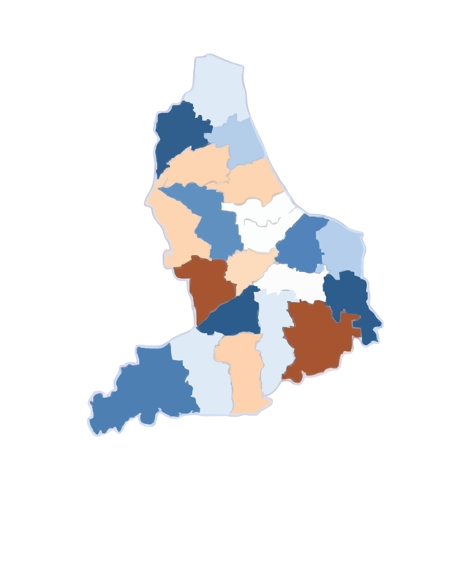

# Noto PATI

> **Pelaporan Infrastruktur & Transparansi Anggaran Kabupaten Pati**  

Noto PATI ("Noto" dalam bahasa Jawa berarti *menata*) adalah web pelaporan infrastruktur warga Kabupaten Pati (jalan rusak, drainase tersumbat, lampu PJU mati, jembatan rusak) yang menghubungkan laporan fisik dengan transparansi data belanja infrastruktur pada APBD Kabupaten Pati T.A. 2025.

Project ini merupakan prototipe civic-tech independen, bukan kanal aduan resmi Pemerintah
Kabupaten Pati. Fokus utamanya adalah membuat laporan warga lebih mudah ditelusuri,
menampilkan status secara transparan, dan membantu warga memahami konteks anggaran
infrastruktur.




Asset peta ini digunakan sebagai gambaran visual wilayah Pati. Validasi lokasi laporan
dilakukan di server menggunakan polygon PostGIS yang di-seed melalui data
[`pati.geojson`](./pati.geojson), bukan berdasarkan gambar peta atau bounding box.

### Alur utama aplikasi

1. Pengunjung dapat menjelajahi daftar dan detail laporan publik, peta, edukasi, serta data APBD.
2. Laporan dapat dikirim secara anonim atau oleh warga yang masuk; warga terautentikasi juga dapat melihat laporan miliknya.
3. Form laporan mendukung kategori, judul, deskripsi, hingga tiga foto kamera, dan lokasi perangkat.
4. Server memvalidasi masukan dan memastikan titik laporan berada di wilayah Kabupaten Pati sebelum menyimpan laporan ke Supabase.
5. Foto disimpan di bucket privat dan disajikan melalui signed URL sesuai kebutuhan akses.
6. Warga terautentikasi dapat mendukung laporan warga lain dan memberi ulasan pada laporan yang memenuhi syarat.
7. Admin mengelola verifikasi dan tindak lanjut laporan melalui dashboard terlindungi.
8. Analisis foto AI bersifat opsional; warga tetap dapat menyelesaikan pelaporan secara manual.


---

## Tech Stack Utama

* **Framework:** [Next.js 15](https://nextjs.org/) (App Router, Turbopack)
* **Library:** [React 19](https://react.dev/) + [TypeScript](https://www.typescriptlang.org/)
* **Styling & UI:** [Tailwind CSS v4](https://tailwindcss.com/) + [shadcn/ui](https://ui.shadcn.com/) (preset Nova) + [Lucide Icons](https://lucide.dev/)
* **Form & Validasi:** [Zod](https://zod.dev/) + [React Hook Form](https://react-hook-form.com/)
* **Peta & Visualisasi:** [MapLibre GL JS](https://maplibre.org/maplibre-gl-js/docs/) + GeoJSON & [Recharts](https://recharts.org/)
* **Backend & Database:** [Supabase](https://supabase.com/) (PostgreSQL + PostGIS) + `@supabase/ssr`
* **Testing:** [Vitest](https://vitest.dev/) (Unit/Domain) + [Playwright](https://playwright.dev/) (E2E) + [ESLint](https://eslint.org/)

---

## Prasyarat Sistem

Sebelum memulai, pastikan perangkat Anda telah terpasang:

* **Node.js:** Versi **24 LTS** (direkomendasikan) atau minimal **22 LTS**.
* **Package Manager:** `npm` (disertakan bersama instalasi Node.js).
* **Git:** Versi terbaru.

Verifikasi versi di terminal:
```bash
node -v   # v24.x.x atau v22.x.x
npm -v    # v10.x.x ke atas
git --version
```

---

## Panduan Memulai Cepat (Getting Started)

Ikuti langkah-langkah berikut untuk menjalankan proyek di lingkungan lokal:

### 1. Clone Repository
```bash
git clone https://github.com/Ngab-Rio/Noto-PATI.git
cd Noto-PATI
```

### 2. Install Dependensi
Gunakan `npm install` atau `npm ci` untuk memastikan dependensi terpasang sesuai `package-lock.json`:
```bash
npm ci
```

Gunakan `npm install` hanya jika Anda perlu memperbarui dependency atau `package-lock.json`
belum tersedia.

### 3. Konfigurasi Environment Variables
Salin berkas template environment:
```bash
cp .env.example .env.local
```
Buka file `.env.local` dan isi kredensial proyek Supabase Anda.

Di PowerShell Windows, perintah yang setara adalah:
```powershell
Copy-Item .env.example .env.local
```

Minimal isi variabel berikut agar aplikasi dapat berjalan:

```env
NEXT_PUBLIC_APP_URL=http://localhost:3000
NEXT_PUBLIC_SUPABASE_URL=https://your-project.supabase.co
NEXT_PUBLIC_SUPABASE_PUBLISHABLE_KEY=your-publishable-key
```

`SUPABASE_SERVICE_ROLE_KEY` diperlukan untuk upload foto, signed URL, seed region,
dan operasi server tertentu. Jangan pernah mengcommit `.env.local`, service role key,
atau API key provider.

### 4. Terapkan Database Supabase

Pastikan Supabase CLI sudah terpasang dan project development sudah terhubung. Terapkan
migrasi yang ada di [`supabase/migrations/`](./supabase/migrations/):

```bash
supabase link --project-ref your-project-ref
supabase db push
```

Jika menggunakan Supabase lokal:

```bash
supabase start
supabase db reset
```

### 5. Seed Polygon Kabupaten Pati

Setelah environment Supabase dan migrasi tersedia, seed region Pati:

```bash
npm run seed:region
```

Script ini memakai [`pati.geojson`](./pati.geojson) dan RPC server-side untuk menyimpan
polygon validasi lokasi. Untuk menonaktifkan validasi region sementara di environment
development:

```bash
npm run disable:region
```

Jangan menonaktifkan validasi wilayah pada deployment yang menerima laporan nyata.

### 6. Jalankan Development Server
```bash
npm run dev
```
Buka peramban di [http://localhost:3000](http://localhost:3000).

Halaman penting setelah server berjalan:

| URL | Keterangan |
|---|---|
| `/` | Landing page |
| `/report/new` | Form laporan anonim/authenticated |
| `/map` | Peta laporan publik |
| `/reports` dan `/reports/list` | Daftar laporan publik dan penelusuran laporan |
| `/reports/[id]` | Detail, linimasa, dan status laporan |
| `/my-reports` | Riwayat laporan warga yang masuk |
| `/care` | Direktori edukasi fasilitas publik |
| `/budget` | Transparansi data APBD |
| `/login` dan `/register` | Autentikasi warga |
| `/admin` | Dashboard admin (khusus role admin) |
| `/admin/reports` | Antrean dan pengelolaan laporan |
| `/admin/map` | Peta laporan untuk admin |

---

## Konfigurasi Environment Variables

Aplikasi divalidasi saat startup oleh `src/config/env.client.ts` dan `src/config/env.server.ts`. Jika variabel wajib belum diisi, sistem akan menampilkan pesan diagnostik yang jelas.

| Variabel | Lingkup | Wajib? | Keterangan | Contoh |
|---|---|---|---|---|
| `NEXT_PUBLIC_APP_URL` | Client & Server | Ya | URL basis aplikasi (untuk callback OAuth & metadata) | `http://localhost:3000` |
| `NEXT_PUBLIC_SUPABASE_URL` | Client & Server | Ya | Endpoint API project Supabase | `https://xyz.supabase.co` |
| `NEXT_PUBLIC_SUPABASE_PUBLISHABLE_KEY` | Client & Server | Ya | Publishable / Anon API key Supabase | `sb_publishable_...` |
| `NEXT_PUBLIC_ENABLE_MOCK_LOCATION` | Client | Opsional | Aktifkan simulasi titik koordinat Pati untuk pengujian | `true` atau `false` |
| `SUPABASE_SERVICE_ROLE_KEY` | **Server Only** | Opsional | Kunci admin untuk skrip operasional data (Rahasia) | `eyJhbGci...` |
| `CRON_SECRET` | **Server Only** | Opsional | Token otorisasi endpoint cron internal | `secret-token` |
| `AI_VISION_BASE_URL` | **Server Only** | Opsional | Base URL OpenAI-compatible vision API (tanpa /chat/completions) | `https://api.openai.com/v1` |
| `AI_VISION_API_KEY` | **Server Only** | Opsional | API key untuk vision provider (Rahasia) | `sk-...` atau `gsk_...` |
| `AI_VISION_MODEL` | **Server Only** | Opsional | Model name untuk vision analysis | `gpt-4-vision-preview` |
| `AI_ANALYSIS_ALLOWED_ORIGINS` | **Server Only** |  **TEMPORARY** | **Dev-only:** Origins tambahan untuk tunnel testing (akan dihapus di production) | `https://tunnel.example` |

>  **Catatan Penting:**  
> - **`AI_ANALYSIS_ALLOWED_ORIGINS`** adalah variable **SEMENTARA** hanya untuk development dengan tunnel (ngrok, VS Code dev tunnels).  
> - Variable ini **HARUS DIHAPUS** saat deploy ke production.  
> - Production hanya akan menggunakan `NEXT_PUBLIC_APP_URL` sebagai allowed origin.  
> - Lihat `docs/AI_PHOTO_ANALYSIS.md` untuk detail lengkap.

---

## Perintah yang Tersedia (NPM Scripts)

| Perintah | Deskripsi |
|---|---|
| `npm run dev` | Menjalankan development server lokal dengan Turbopack (`http://localhost:3000`) |
| `npm run build` | Membuat bundle production yang teroptimasi |
| `npm run start` | Menjalankan server aplikasi production hasil build |
| `npm run lint` | Memeriksa kepatuhan kode menggunakan ESLint |
| `npm run typecheck` | Memeriksa validitas tipe data TypeScript (`tsc --noEmit`) |
| `npm run test` | Menjalankan seluruh pengujian unit/domain via Vitest |
| `npm run test:watch` | Menjalankan Vitest dalam mode interaktif (watch mode) |
| `npm run test:e2e` | Menjalankan pengujian end-to-end browser dengan Playwright |
| `npm run seed:region` | Memasukkan polygon Kabupaten Pati ke database |
| `npm run disable:region` | Menonaktifkan/menghapus region Pati dari database development |
| `npm run scrape:apbd` | Mengambil snapshot data APBD melalui skrip operasional |
| `npm run import:apbd` | Mengimpor data APBD ke database melalui skrip operasional |

---

## Fitur yang Sudah Diimplementasikan

### Pelaporan dan akun warga

- Pelaporan dapat dibuat oleh pengunjung tanpa akun maupun warga yang masuk dengan email atau Google melalui Supabase Auth.
- Form laporan mendukung kategori infrastruktur, judul, deskripsi, hingga tiga foto kamera, kompresi foto di sisi klien, dan lokasi perangkat.
- Lokasi laporan divalidasi di server terhadap polygon Kabupaten Pati menggunakan PostGIS; reverse geocoding tersedia sebagai bantuan informasi lokasi.
- Foto laporan disimpan di storage privat dan disajikan menggunakan signed URL.
- Analisis foto berbasis AI tersedia secara opsional dengan pembatasan request dan fallback ke pengisian manual.
- Warga yang masuk dapat melihat riwayat laporannya sendiri.

### Penelusuran, dukungan, dan status laporan

- Daftar publik mendukung pencarian, filter, pengurutan, serta halaman detail laporan.
- Peta publik menampilkan lokasi laporan dengan marker terklaster, mode heatmap, filter status, dan pilihan basemap.
- Detail laporan menampilkan status dan linimasa pembaruan. Perubahan status publik dapat diterima melalui Supabase Realtime; tampilan tetap menyediakan status koneksi/fallback jika pembaruan langsung tidak tersedia.
- Warga terautentikasi dapat mendukung laporan milik warga lain. Satu akun hanya dapat mendukung laporan yang sama sekali, dan identitas pendukung tidak ditampilkan ke publik.
- Warga terautentikasi dapat memberi satu ulasan pada laporan yang telah selesai sesuai aturan akses; ringkasan rating ditampilkan pada laporan yang memiliki penilaian.
- Laporan duplikat dapat digabungkan, dan data dukungan laporan terkait digunakan dalam pengurutan perhatian warga.

### Edukasi dan transparansi anggaran

- Noto PATI Care menyediakan materi edukasi berdasarkan kategori kerusakan, beserta panduan keselamatan warga.
- Kategori yang belum memiliki materi khusus—termasuk vandalisme—menggunakan panduan umum fasilitas publik pada konteks edukasi laporan.
- Halaman APBD menyajikan snapshot data anggaran dan realisasi beserta periode dan sumber yang tersedia di database.

### Pengelolaan admin

- Area admin dilindungi pemeriksaan autentikasi dan role admin.
- Dashboard merangkum laporan berdasarkan status, tenggat SLA, antrean, dan aktivitas terbaru.
- Admin dapat meninjau detail laporan, memverifikasi atau menolak laporan, menggabungkan duplikat, memperbarui status sesuai transisi, serta mencatat tindak lanjut dan bukti penyelesaian.
- Daftar laporan admin mendukung pencarian, filter status/kategori/SLA, pengurutan, dan ekspor CSV.
- Peta admin menampilkan laporan dan ringkasan status untuk kebutuhan pemantauan.

### Pengalaman dan kualitas aplikasi

- Halaman publik dan admin memiliki tampilan responsif untuk penggunaan di perangkat mobile.
- Navigasi internal menampilkan indikator saat perpindahan halaman berlangsung; fallback loading menggunakan skeleton dan status yang dapat diumumkan teknologi bantu.
- Pengujian otomatis tersedia melalui Vitest, dengan perintah typecheck, lint, build, dan E2E yang disediakan di NPM scripts.


## Dokumentasi Terkait

Untuk pemahaman mendalam tentang standar dan alur kerja teknis, silakan baca:
* [**`docs/TESTING.md`**](./docs/TESTING.md) — Panduan pengujian, alur quality gate, dan cheatsheet testing.
* [**`docs/ADMIN_SETUP.md`**](./docs/ADMIN_SETUP.md) — Cara membuat user admin dan mengakses dashboard administrasi.
* [**`docs/ADMIN_TESTING_GUIDE.md`**](./docs/ADMIN_TESTING_GUIDE.md) — Testing admin access control dan role-based permissions.
* [**`docs/AUTHENTICATION.md`**](./docs/AUTHENTICATION.md) — Autentikasi, role, dan aturan akses warga/admin.
* [**`docs/PUBLIC_MAP.md`**](./docs/PUBLIC_MAP.md) — Peta publik, endpoint data, dan batasan privasi.
* [**`docs/NOTO_PATI_CARE.md`**](./docs/NOTO_PATI_CARE.md) — Cakupan konten dan prinsip keselamatan Noto PATI Care.
* [**`docs/SLA_TIMELINE.md`**](./docs/SLA_TIMELINE.md) — Linimasa status dan perhitungan SLA laporan.
* [**`ARCHITECTURE.md`**](./ARCHITECTURE.md) — Rincian arsitektur 4 lapisan, batasan server/client, dan aturan database.
* [**`DEVELOPMENT.md`**](./DEVELOPMENT.md) — Konvensi pengembangan lokal, standar kode, dan error handling.
* [**`PRD.md`**](./PRD.md) — Product Requirement Document (kebutuhan produk dan kriteria penerimaan).
* [**`docs/PRODUCT_SCOPE.md`**](./docs/PRODUCT_SCOPE.md) — Batasan ruang lingkup fitur MVP vs P2.
* [**`docs/SECURITY.md`**](./docs/SECURITY.md) — Kebijakan keamanan, pengelolaan rahasia, dan kepatuhan privasi (UU PDP).
* [**`docs/ASSET_MANAGEMENT.md`**](./docs/ASSET_MANAGEMENT.md) — Struktur dan penggunaan asset visual.

---

##  Kontribusi

Silakan tinjau [`.github/CONTRIBUTING.md`](./.github/CONTRIBUTING.md) untuk konvensi penamaan branch, tata cara membuat Pull Request, dan standar commit.
