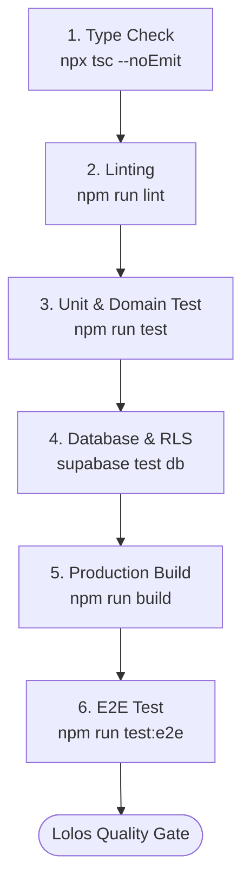

# Panduan Pengujian & Kualitas (TESTING.md) — Noto PATI

> **Versi:** 1.0  
> **Turunan dari:** `ARCHITECTURE.md § 13` & `DEVELOPMENT.md § 1.1`  
> **Tujuan:** Panduan teknis terpusat untuk menjalankan, menulis, dan memverifikasi kualitas kode di Noto PATI.

---

## 1. Alur Quality Gate (Urutan Pemeriksaan)

Sebelum membuat Pull Request atau menggabungkan kode ke branch utama, setiap pengembang wajib menjalankan urutan pemeriksaan berikut:



| Tahap | Perintah | Tujuan | Wajib di CI? |
|---|---|---|---|
| **1. Type Check** | `npx tsc --noEmit` | Memastikan tidak ada pelanggaran tipe data TypeScript | Ya |
| **2. Linting** | `npm run lint` | Menegakkan standar gaya kode dan batas import | Ya |
| **3. Unit & Domain** | `npm run test` (Vitest) | Memverifikasi logika murni bisnis (status, SLA, APBD) | Ya |
| **4. Database & RLS** | `supabase test db` (pgTAP) | Memastikan isolasi hak akses data Warga vs Admin | Ya |
| **5. Build Check** | `npm run build` | Menjamin bundle server-only tidak bocor ke klien | Ya |
| **6. End-to-End** | `npm run test:e2e` (Playwright) | Menguji alur pengguna utuh dari browser | Ya |

---

## 2. Perintah Cepat (Cheatsheet)

### Unit Testing (Vitest)
```bash
# Menjalankan seluruh unit test sekali jalan
npm run test

# Menjalankan test dalam mode watch (aktif saat koding)
npm run test:watch

# Menjalankan test pada file tertentu
npx vitest run src/domain/sla.test.ts

# Melihat cakupan pengujian (coverage)
npx vitest run --coverage
```

### End-to-End Testing (Playwright)
```bash
# Menjalankan seluruh pengujian E2E (headless)
npm run test:e2e

# Menjalankan pengujian E2E dengan UI interaktif
npx playwright test --ui

# Menjalankan pengujian khusus file
npx playwright test e2e/landing-page.spec.ts
npx playwright test e2e/navigation.spec.ts
npx playwright test e2e/auth-flow.spec.ts

# Menjalankan dengan browser tertentu
npx playwright test --project=chromium
npx playwright test --project=firefox

# Mode debug (step-by-step)
npx playwright test --debug

# Install browsers (pertama kali)
npx playwright install
```

### Database Testing (pgTAP & Supabase CLI)
```bash
# Menjalankan seluruh pengujian RLS dan fungsi DB lokal
supabase test db
```

---

## 3. Strategi Pengujian per Lapisan

Sesuai dengan arsitektur 4 lapisan Noto PATI, setiap lapisan memiliki pendekatan pengujian yang berbeda:

### 3.1 Lapisan 1: Domain (Murni TypeScript)
* **Karakteristik:** Tidak memiliki dependensi ke React, Next.js, maupun Supabase.
* **Alat:** `Vitest`.
* **Fokus Uji:**
  - `report-status.test.ts`: Memastikan matriks transisi status yang sah (contoh: status `received` tidak boleh langsung melompat ke `resolved` tanpa melalui verifikasi).
  - `sla.test.ts`: Perhitungan sisa waktu dan status keterlambatan berdasarkan timestamp server dan tenggat target.
  - `budget.test.ts`: Penjumlahan matematis pagu anggaran APBD 2025 secara deterministik (bukan aproksimasi AI).

### 3.2 Lapisan 2: Validasi & Schema Form
* **Karakteristik:** Form pelaporan dan filter peta yang berjalan di browser.
* **Alat:** `Vitest` + Zod schema validation.
* **Fokus Uji:**
  - Input teks tidak boleh kosong atau melebihi batas karakter.
  - Jumlah foto wajib 1 hingga 3 lembar.
  - Format koordinat numerik (`longitude`, `latitude`) berada dalam rentang yang valid.

### 3.3 Lapisan 3: Database, RPC, dan RLS (PostgreSQL + PostGIS)
* **Karakteristik:** Garis pertahanan terakhir integritas data.
* **Alat:** `pgTAP` di folder `supabase/tests/`.
* **Fokus Uji:**
  - **Uji Hak Akses (RLS):** Pengunjung anonim dan Warga biasa dilarang keras membaca catatan internal admin atau identitas pelapor anonim.
  - **Uji Atomisitas:** Memastikan fungsi RPC `create_report` membatalkan seluruh transaksi jika salah satu foto gagal dicatat.
  - **Uji Spasial:** Koordinat yang berada di luar poligon batas Kabupaten Pati ditolak oleh database (`ST_Covers`).

### 3.4 Lapisan 4: Pengujian Lintas Lapisan (E2E Playwright)
* **Karakteristik:** Menguji alur pengguna di lingkungan browser nyata.
* **Alat:** `Playwright` di folder `e2e/`.
* **Fokus Uji:**
  - **Landing Page (`e2e/landing-page.spec.ts`):**
    - Hero section dengan CTAs auth-aware
    - "How to Report" section (5 langkah)
    - Status badges showcase dengan badge "Data Simulasi"
    - Featured reports dengan mock data indicator
    - Footer dengan disclaimers
  - **Public Navigation (`e2e/navigation.spec.ts`):**
    - Navigasi guest user (/, /map, /budget)
    - Navigasi authenticated user (profile, report/new)
    - Admin dashboard access (/admin)
    - Responsive mobile menu
  - **Auth Flow (`e2e/auth-flow.spec.ts`):**
    - Login/register pages
    - Form validation
    - Redirect preservation (?next parameter)
    - Unauthorized access handling
* **Mocking Wajib di Browser:**
  1. **Geolocation API:** Harus di-mock ke titik koordinat valid di Kabupaten Pati (misalnya alun-alun Pati: `-6.7554, 111.0378`).
  2. **Camera (`getUserMedia`):** Di-mock menggunakan gambar dummy statis agar tidak memblokir perizinan hardware di server CI.
* **Helper Utilities:** `e2e/helpers/auth.ts` menyediakan fungsi `loginUser()`, `logoutUser()`, `isAuthenticated()` untuk setup test authentication.

---

## 4. Konvensi Penulisan Berkas Pengujian

1. **Unit test domain/fitur:** Ditempatkan berdampingan (*co-located*) dengan file implementasi menggunakan ekstensi `.test.ts`.  
   *Contoh:* `src/domain/sla.ts` diuji oleh `src/domain/sla.test.ts`.
2. **E2E test:** Ditempatkan di dalam direktori `e2e/` dengan ekstensi `.spec.ts`.  
   *Contoh:* `e2e/landing-page.spec.ts`, `e2e/navigation.spec.ts`, `e2e/auth-flow.spec.ts`.
3. **E2E helpers:** Utilitas reusable di `e2e/helpers/` untuk authentication, page objects, dan mocking.
4. **Database test:** Ditempatkan di `supabase/tests/` dengan ekstensi `.sql`.

---

## 5. Checklist Kualitas Pra-Merge (Checklist PR)

Gunakan checklist ini sebelum mengajukan Pull Request:

- [ ] **Type Check:** `npx tsc --noEmit` lolos tanpa error.
- [ ] **Linting:** `npm run lint` lolos tanpa pelanggaran aturan.
- [ ] **Unit Tests:** Semua pengujian domain lulus (`npm run test`).
- [ ] **E2E Tests:** Playwright tests untuk critical paths lulus (`npm run test:e2e`).
- [ ] **Batas Server/Klien:** File di `src/server/` memuat `import "server-only"`.
- [ ] **Data Demo & Mock:** Tidak menggunakan kredensial/API key nyata atau data pribadi warga dalam pengujian.
- [ ] **Data Simulasi Label:** Mock data ditandai dengan badge "Data Simulasi" sesuai `DISCLAIMERS.dataSimulation`.
- [ ] **Error Boundaries:** Halaman baru memiliki `error.tsx` untuk graceful error handling.
- [ ] **Loading States:** Async pages memiliki `loading.tsx` untuk UX yang lebih baik.
